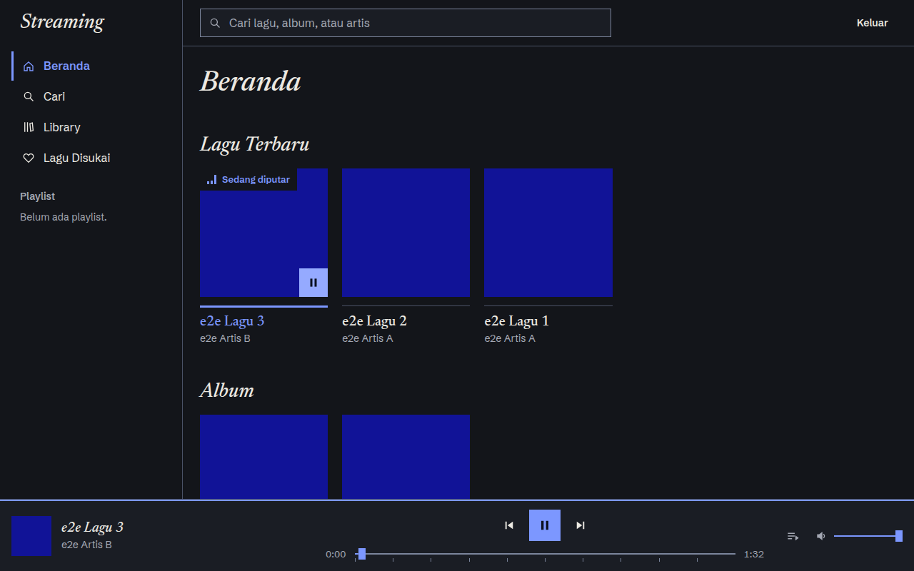
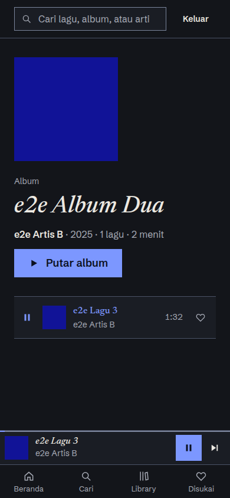

# Streaming

[](https://github.com/bayuevm-wq/Streaming/actions/workflows/app.yml)
[](https://github.com/bayuevm-wq/Streaming/actions/workflows/db-tests.yml)
[](https://github.com/bayuevm-wq/Streaming/actions/workflows/e2e.yml)

Aplikasi streaming musik berbasis web, dibangun sebagai proyek portofolio: **Next.js 16 (App Router) + Tailwind v4 + Supabase**. Pemutarnya tidak pernah putus saat pindah halaman, pengunjung bisa mencoba tanpa mendaftar, dan setiap batas (kuota, ukuran, kepemilikan data) ditegakkan di database, bukan di antarmuka.

> **Demo:** _belum ter-deploy._ Langkah deploy ada di [`docs/deploy.md`](docs/deploy.md). Tautan akan ditambahkan di sini setelah produksi berjalan.
>
> Data contoh di tangkapan layar berasal dari katalog sintetis CI (sampul biru polos, MP3 sunyi), bukan musik sungguhan. Katalog asli belum diisi (lihat [Sumber audio](#sumber-audio-katalog)).

<p>
  
  
</p>

## Fitur

- **Pemutar global** dengan antrean, auto-lanjut, seek lewat keyboard, dan satu elemen audio yang hidup di luar siklus render React, sehingga musik berlanjut lintas halaman. Lagu rusak dilewati satu kali dengan satu notifikasi.
- **Katalog publik**: beranda, album, artis, dan 404 yang rapi di dalam kerangka aplikasi.
- **Pencarian** lagu, album, dan artis (RPC `search_all`; `%` dan `_` diperlakukan literal; URL `?q` bisa dibagikan).
- **Suka** dengan UI optimistis dan rollback bila server gagal; **playlist** (buat, ganti nama, hapus dengan konfirmasi, tambah/hapus lagu, batas 20 playlist dan 200 lagu dengan pesan yang jelas).
- **Upload lagu pribadi** (MP3 ≤ 10 MB, maks 3 lagu aktif, terhapus otomatis setelah 24 jam): reservasi di database, unggah resumable (TUS) langsung ke Storage, lalu validasi **isi** file di server. Library menampilkan slot `n/3` dan sisa waktu.
- **Anonim tanpa daftar**: "Coba tanpa daftar" memakai sign-in anonim Supabase yang dilindungi CAPTCHA (Turnstile). Akun anonim yang tidak aktif 7 hari dibersihkan otomatis beserta file-nya.
- **Mobile**: di layar ≤ 760px sidebar dan player bar digantikan mini-player satu baris, pemutar penuh, dan navigasi bawah (±120px, sebelumnya ±220px).
- **Design system "Tinta Cetak"**: mode gelap, serif editorial, sudut tajam, fokus kobalt, status selalu ikon + teks ([`docs/design-system.md`](docs/design-system.md), halaman review `/gaya`).

## Tangkapan layar

Disimpan per fase; dihasilkan E2E (Chrome) dan diperbarui hanya secara manual ([cara](docs/images/README.md)).

| Fase | Isi |
|---|---|
| [Fase 2](docs/images/fase2/README.md) | Beranda, album, artis, antrean, mini-player, pemutar penuh (desktop 1280px dan ponsel 390px) |
| [Fase 3](docs/images/fase3/README.md) | Pencarian, Lagu Disukai, playlist |
| [Fase 4](docs/images/fase4/README.md) | Library (slot n/3), unggah: normal, sedang mengunggah, kuota penuh, MP3 palsu ditolak |

## Keputusan yang layak dilihat

| Masalah | Keputusan | Bukti |
|---|---|---|
| Batas "maks 3 lagu" tidak boleh bisa dilompati dengan dua permintaan paralel | Trigger Postgres mengunci baris profil (`FOR UPDATE`) sebelum menghitung; urutan kunci tetap menghindari deadlock | [`supabase/tests/concurrency.sh`](supabase/tests/concurrency.sh), uji SQL T-kuota |
| Ekstensi dan MIME file hanyalah klaim klien | Pemeriksaan isi di server: ukuran dari `Content-Range`, ID3, **3 frame Layer III beruntun**; file `.exe` yang diganti nama menjadi `.mp3` ditolak | [`lib/audio/mp3.ts`](lib/audio/mp3.ts), E2E `upload.spec.ts` |
| Upload ≤ 10 MB tidak muat di fungsi serverless (batas body ±4,5 MB) | Browser mengunggah **langsung** ke Storage (TUS), dibatasi policy `owns_pending_object` | spike S1/S2 di CI ([`architecture.md` §14.1](docs/architecture.md)) |
| Klik "Berikutnya" berulang bisa membunyikan dua audio | Token permintaan per pemuatan; hasil basi dibuang; satu kegagalan = satu lompatan | [`lib/player/store.test.ts`](lib/player/store.test.ts), E2E |
| File yatim di Storage bila baris dihapus lebih dulu | Job pembersih menghapus **file dulu, baris kemudian**, idempoten, dengan lease agar tak tumpang tindih | [`supabase/tests/api/cleanup.test.mjs`](supabase/tests/api/cleanup.test.mjs) |
| CSRF pada Route Handler | `Origin` dibandingkan dengan `Host`, bukan `req.url` (yang salah di balik `next start`; temuan dari E2E) | `lib/security/origin.ts`, E2E |
| Safari bisa menolak `play()` setelah `await` jaringan | Signed URL pribadi di-pra-ambil dan dipakai sinkron saat diketuk | S4 di [`architecture.md` §14.1](docs/architecture.md) |

## Pengujian

Semua berjalan di GitHub Actions terhadap **Supabase CLI sungguhan** (bukan tiruan):

| Workflow | Isi |
|---|---|
| `app` | lint, tipe, build, uji unit (pemutar, suka, playlist, upload, format, origin, cache URL), kontras WCAG, keyboard (CDP Chrome) |
| `db-tests` | uji SQL (RLS, trigger, batas), konkurensi, Auth anonim + CAPTCHA, spike Storage (Range 206, TUS), job pembersih, seed, keep-alive |
| `e2e` | Playwright: Chrome (alur utama, mobile, unggah, playlist, isolasi dua pengunjung) dan WebKit (spike S4) |

Jalankan lokal: `npm run lint && npx tsc --noEmit && npm run build` dan skrip `npm run test:*` di `package.json`.

## Batasan yang diakui

- **Safari iOS asli belum diuji.** WebKit desktop di CI bukan iOS dan aturan autoplay iOS lebih ketat; ikuti uji manual di [`docs/deploy.md`](docs/deploy.md) setelah deploy.
- **Job pembersih belum berjalan di proyek hosted**: logikanya diuji di Supabase CLI lokal, tetapi pembungkus Edge Function (Deno) dan penjadwalan `pg_cron` baru bisa dibuktikan setelah deploy.
- Katalog asli (`scripts/seed/catalog.json`) belum diisi; CI memakai katalog sintetis.
- Batas 200 lagu per playlist diuji di SQL dan pesannya di unit test, tidak lewat UI (seed CI hanya 3 lagu).
- Lighthouse dan audit aksesibilitas otomatis: lihat [Kualitas](#kualitas) untuk hasil terbaru.

## Kualitas

Diukur otomatis di CI pada build produksi dengan data contoh sintetis ([run](https://github.com/bayuevm-wq/Streaming/actions/runs/42216852674)), bukan di produksi.

**Lighthouse mobile** (emulasi ponsel + throttling simulasi bawaan; median 3 run per halaman; `scripts/lighthouse.mjs`):

| Halaman | Performance | Accessibility | Best Practices | LCP |
|---|---|---|---|---|
| Beranda | 100 | 100 | 100 | 0,9 s |
| Album | 86 | 100 | 100 | 4,1 s |
| Artis | 100 | 100 | 100 | 0,9 s |
| Pencarian | 100 | 100 | 100 | 0,8 s |
| Library | 100 | 100 | 100 | 0,8 s |
| Unggah | 100 | 100 | 100 | 0,8 s |
| Playlist | 84 | 100 | 100 | 4,5 s |

Target spec (beranda mobile Performance ≥ 85, Accessibility ≥ 90) **terpenuhi**; ambang itu dijaga di CI (beranda: keduanya; halaman lain: Accessibility ≥ 90). Catatan jujur: skor Performance bervariasi antar run di runner bersama (satu run bisa 84–86 pada halaman yang sama), dan **album dan playlist konsisten punya LCP ±4 detik** di emulasi ponsel; penyebabnya belum didiagnosis (kandidat: rantai pemuatan sampul/font di halaman berkepala besar). Angka ini bukan jaminan untuk produksi sungguhan dengan sampul asli.

**Aksesibilitas otomatis:** axe-core (WCAG 2.0/2.1/2.2 A dan AA + praktik terbaik) pada 15 layar dan dialog, desktop dan ponsel (`e2e/a11y.spec.ts`): **0 pelanggaran**. Audit pertama menemukan satu jenis pelanggaran nyata (WCAG 2.5.3, nama aksesibel tombol putar tidak memuat nomor urut yang tampak) dan sudah diperbaiki. Kontras (`test:contrast`) dan keyboard (`test:keyboard`) punya uji sendiri. Otomasi hanya menangkap sebagian masalah: uji dengan pembaca layar dan Safari iOS tetap manual.

## Pengembangan lokal

Prasyarat: Node 22+, Docker (untuk Supabase lokal), Supabase CLI 3.0.0.

```bash
npm install
cp .env.example .env.local                 # isi nilai dari `supabase status`
export SUPABASE_AUTH_CAPTCHA_SECRET=1x0000000000000000000000000000000AA   # secret uji Turnstile
supabase start && supabase db reset        # skema, RLS, trigger, bucket
node scripts/seed/make-e2e-catalog.ts /tmp/katalog && node scripts/seed.ts --relaxed --catalog /tmp/katalog/catalog.json
npm run dev                                # http://localhost:3000
```

Catatan: ini Next.js 16 (`proxy.ts` menggantikan middleware, Cache Components aktif). Baca `node_modules/next/dist/docs/` sebelum mengubah konvensi rute.

## Dokumen

| Dokumen | Isi |
|---|---|
| [`docs/spec.md`](docs/spec.md) | Spesifikasi MVP: user story, acceptance criteria, prioritas |
| [`docs/architecture.md`](docs/architecture.md) | Arsitektur, skema, keputusan, spike S1–S6, rencana fase |
| [`docs/design-system.md`](docs/design-system.md) | Token, komponen, aturan aksesibilitas |
| [`docs/deploy.md`](docs/deploy.md) | Checklist deploy produksi (langkah yang kamu kerjakan sendiri) |
| [`supabase/migrations/`](supabase/migrations/) | Skema, RLS, trigger, policy Storage (satu-satunya salinan SQL) |
| [`supabase/tests/`](supabase/tests/README.md) | Uji SQL, konkurensi, dan API |

## Sumber audio katalog

Setiap lagu seed dicatat sumber dan lisensinya di bawah (dihasilkan `node scripts/seed.ts --dry-run --readme` dari `scripts/seed/catalog.json`). Hanya Pixabay Content License atau CC0; lagu NC tidak dipakai. Lihat [`scripts/seed/README.md`](scripts/seed/README.md) untuk cara mengisi katalog.

<!-- seed-sources:start -->
_Katalog belum diisi._
<!-- seed-sources:end -->

## Keep-alive

Proyek Supabase Free di-pause bila aktivitas database rendah selama 7 hari. Workflow [`keepalive`](.github/workflows/keepalive.yml) memanggil RPC `ping()` tiap hari. Isi secret repositori `SUPABASE_URL` dan `SUPABASE_ANON_KEY` (anon key, bukan service role); selama belum diisi, workflow hanya memberi pemberitahuan. GitHub dapat menonaktifkan workflow terjadwal pada repositori publik yang lama tidak aktif; jalankan manual lewat tab Actions (`workflow_dispatch`) bila ada email peringatan pause dari Supabase.
