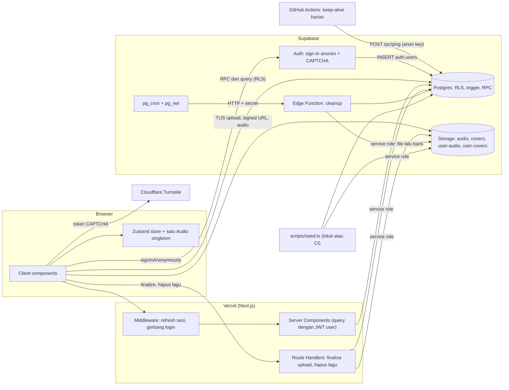
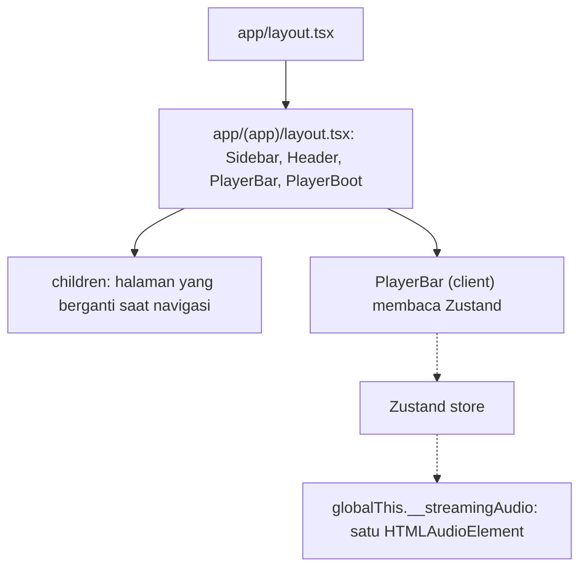
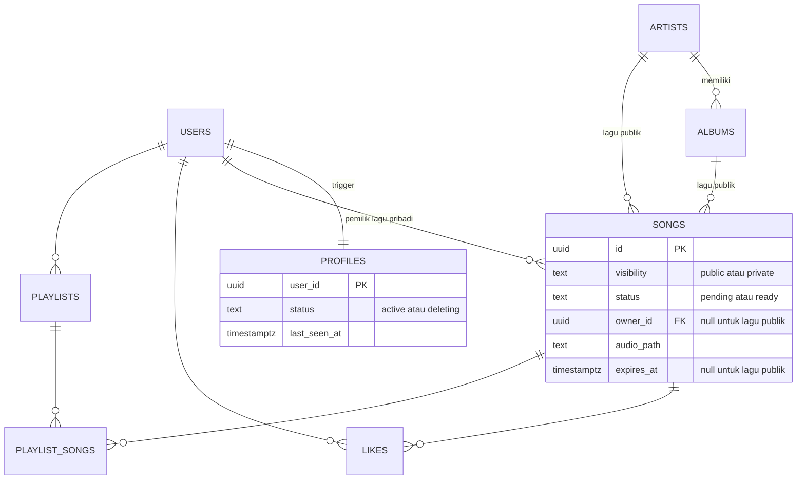
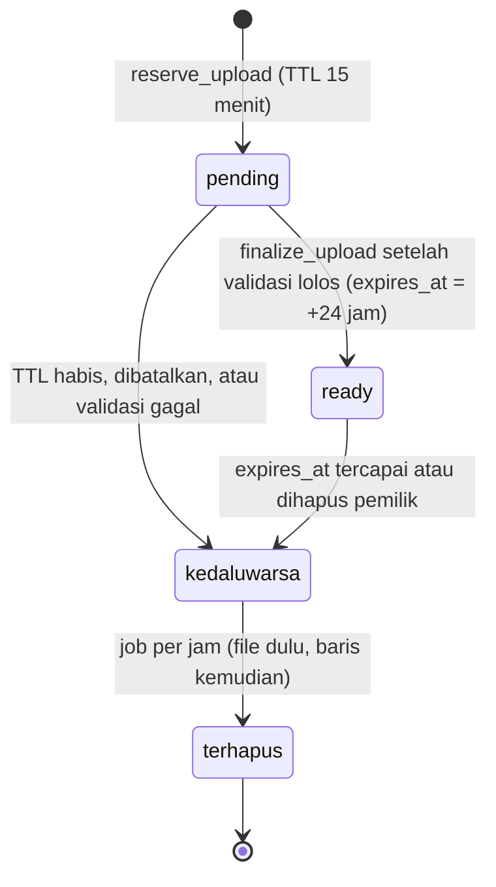
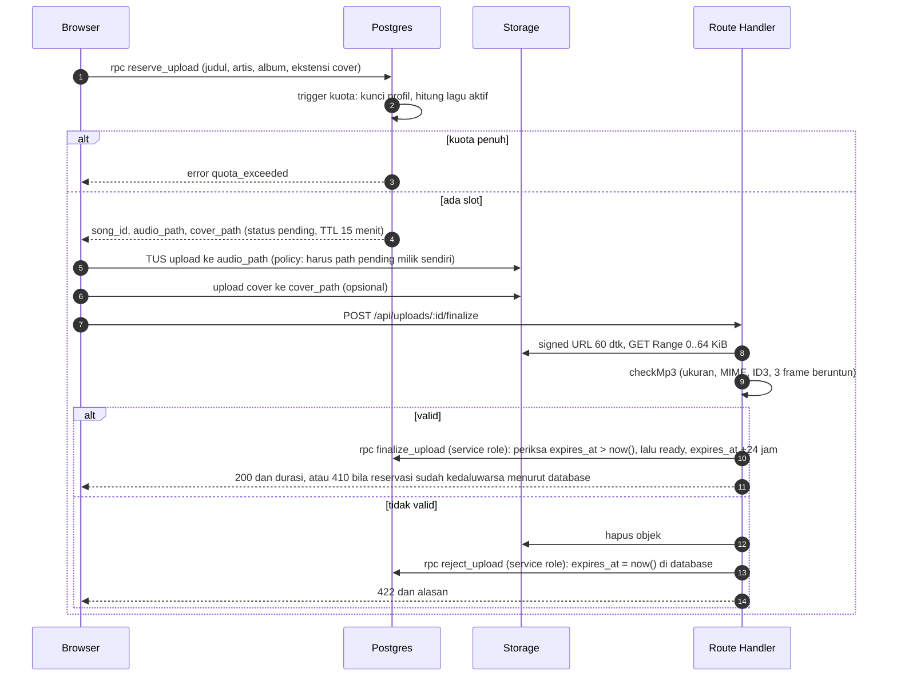
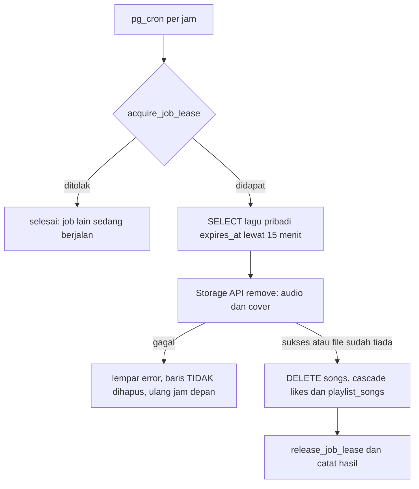
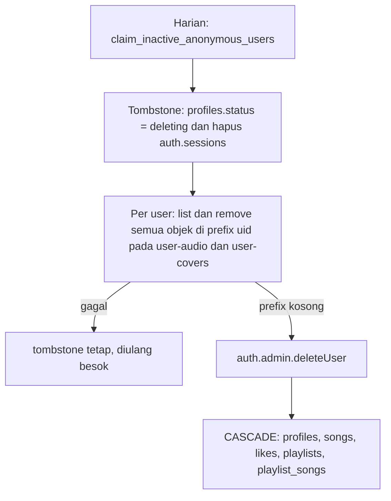
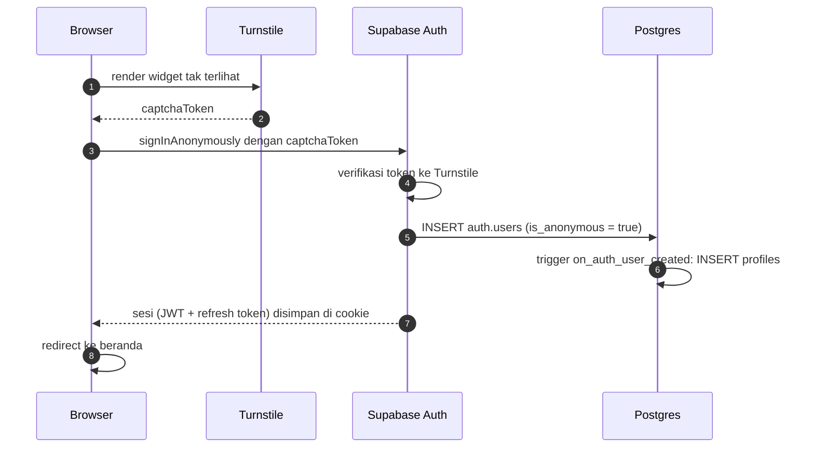
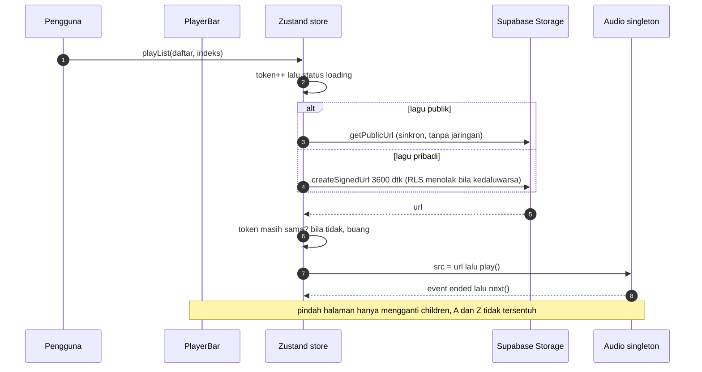

# Streaming — Arsitektur MVP

**Status:** Draft v1 · **Tanggal:** 2026-11-05 · **Sumber:** [`docs/spec.md`](./spec.md) · **Stack:** Next.js (App Router) + Tailwind + Supabase (Postgres, Auth, Storage, Edge Functions) + Zustand

> **Yang sudah dan belum diverifikasi.** **Terverifikasi di Supabase CLI sungguhan lewat GitHub Actions** (job `db-tests`, [run terbaru yang lulus](https://github.com/bayuevm-wq/Streaming/actions/runs/42059170726); badge README menunjukkan status terkini): (1) spike **S6**: 90 uji SQL + uji konkurensi, migrasi 0001–0005 diterapkan `supabase db reset` tanpa perubahan; (2) spike **S5**: `signInAnonymously` sungguhan memicu trigger `profiles`; (3) **F1**: CAPTCHA ditegakkan server (tanpa token → 400 `captcha_failed`); (4) spike **S3**: `auth.admin.deleteUser` meng-cascade `profiles`, playlist, dan lagu pribadi, serta `DELETE FROM auth.sessions` dari fungsi SECURITY DEFINER diizinkan; (5) isolasi dua pengunjung dan kuota 3 lagu lewat PostgREST sungguhan. Tiga batas (kuota lagu, 20 playlist, penyimpanan global) terbukti sensitif lewat kontrol tanpa kunci (§7); unit test `mp3.ts` lulus. Juga lulus di CI ([run 42060874708](https://github.com/bayuevm-wq/Streaming/actions/runs/42060874708)): (6) **F9** seed: 21 skenario aturan katalog offline, serta integrasi (unggah ke bucket publik, baris DB, idempoten, klien tak bisa menulis katalog); (7) **F20** keep-alive: `scripts/keepalive.sh` terhadap `ping()` asli pada tiga skenario (sukses, dilewati tanpa secret, gagal dengan kunci salah). **Masih belum diuji atau belum selesai:** tombol "Coba tanpa daftar" + widget Turnstile di browser sungguhan (UI baru lolos lint, tipe, dan build); Storage API/TUS dan pembacaan Range (S1, S2); Safari (S4); Edge Function `cleanup`; eksekusi workflow `keepalive` di GitHub (terdaftar aktif, tetapi pemicuan manual mendapat HTTP 500 dari API GitHub dua kali, jadi baru jadwal harian yang akan membuktikannya); **katalog seed asli belum diisi** (`scripts/seed/catalog.json` kosong: audio (hanya CC0 1.0, CC BY 4.0, atau CC BY-SA 4.0; sumber FMA dan Incompetech) harus diunduh dan dicek lisensinya per halaman lagu oleh pemilik); dan render diagram Mermaid.

> **Sumber kebenaran SQL dan kode.** SQL lengkap hanya ada di [`supabase/migrations/`](../supabase/migrations/) dan validator MP3 hanya di [`lib/audio/mp3.ts`](../lib/audio/mp3.ts); Lampiran A dan B cuma daftar berkas. Kutipan SQL dalam badan dokumen ini **dihasilkan dari berkas migrasi saat dokumen disusun** dan hanya untuk dibaca; bila berbeda dengan berkas migrasi, berkas migrasilah yang benar.

---

## 1. Ringkasan dan jawaban atas empat pertanyaan kunci

Arsitektur ini menaruh **semua aturan penting di database dan Storage (RLS, trigger, policy)** supaya tetap berlaku walau klien dipanggil langsung lewat API. Next.js hanya merender, mengelola sesi, dan menjalankan dua Route Handler yang memerlukan *service role*.

| # | Pertanyaan | Jawaban singkat | Detail |
|---|---|---|---|
| **a** | Bagaimana header MP3 divalidasi di server bila upload langsung dari browser ke Storage? | Server tidak perlu melihat isi **saat** upload; ia memeriksanya **sebelum lagu dipublikasikan**. Browser mengunggah ke path yang sudah dipesan (`pending`); file itu tidak terbaca siapa pun. Browser lalu memanggil `finalize`; Route Handler membaca **64 KiB pertama** lewat HTTP Range dengan service role, memeriksa ukuran, MIME, tag ID3, dan **3 frame MP3 beruntun**. Hanya bila lolos baris menjadi `ready`. | §6 |
| **b** | Bagaimana batas 3 lagu aktif tidak jebol oleh upload paralel? | Trigger `BEFORE INSERT` pada `songs` mengambil `SELECT … FOR UPDATE` pada baris `profiles` milik user, baru menghitung. Transaksi paralel milik user yang sama antre. Terverifikasi: 10 sesi paralel → tepat 3 berhasil; tanpa kunci → 10. | §7 |
| **c** | Urutan penghapusan di job F18? | **Tombstone → file Storage (lewat Storage API) → baris/user.** File selalu dihapus lebih dulu; baris dan user (beserta cascade-nya) terakhir. Kegagalan di langkah mana pun meninggalkan baris sebagai "daftar tugas" yang dicoba ulang. | §8 |
| **d** | Trigger pembuatan `profiles` saat sign-in anonim? | `AFTER INSERT` pada `auth.users` → `INSERT INTO profiles … ON CONFLICT DO NOTHING`. Sign-in anonim memasukkan baris ke `auth.users` (`is_anonymous = true`), jadi trigger menangkapnya. Ditambah *self-heal* di `touch_last_seen()` dan trigger kuota. | §9 |

**Prinsip desain**
1. **Tegakkan di lapisan terdekat dengan data.** UI hanya UX; batas keamanan ada di RLS, trigger, dan policy Storage.
2. **Baris dulu, file kemudian.** Setiap objek di bucket pribadi selalu punya baris `songs` sejak sebelum file ada, sehingga tidak ada file yatim akibat upload yang terputus.
3. **Tidak ada yang bisa membaca file yang belum divalidasi.** Policy baca mensyaratkan baris `ready`.
4. **Service role hanya di server** dan hanya untuk tiga hal: `finalize`, penghapusan lagu, dan job/seed.
5. **Satu sumber kebenaran waktu:** `now()` di database, bukan jam klien atau jam Node. Kedaluwarsa reservasi diputuskan `finalize_upload`, dan penolakan reservasi dilakukan `reject_upload`, bukan perbandingan tanggal di Route Handler.

---

## 2. Konteks dan pendorong desain

| Pendorong (dari spec) | Konsekuensi arsitektur |
|---|---|
| Demo ≤ 3 klik / ≤ 15 dtk, tanpa daftar (F1) | Sign-in anonim + Turnstile mode tak terlihat; tidak ada layar form |
| Audio tidak putus saat pindah halaman (F2) | Pemutar di layout `(app)`; satu `HTMLAudioElement` singleton di luar siklus render; state di Zustand |
| Data tiap pengunjung terisolasi (F1, F7, F8) | RLS per `auth.uid()`; user anonim berperan `authenticated` |
| Katalog read-only untuk klien, diisi lewat seed (F9) | Tidak ada policy tulis katalog; seed memakai service role |
| Upload pribadi: MP3, ≤ 10 MB, ≤ 3 lagu, 24 jam (F5) | Alur *reserve → upload → verify → publish*; trigger kuota; `expires_at`; job pembersih |
| File ≤ 10 MB tidak boleh lewat fungsi serverless Vercel (batas body ±4,5 MB) | Upload **langsung** ke Storage (TUS), validasi dengan membaca sebagian file |
| Free tier Supabase (F18, F20): DB 500 MB, Storage 1 GB, egress 5 GB; **di-pause bila aktivitas database rendah 7 hari** | Batas ketat (3 lagu/user, 500 MB pribadi global, 20 playlist, 200 lagu/playlist), pembersihan otomatis, CAPTCHA, dan keep-alive harian (§13.2) |
| Hourly job | Vercel Cron paket Hobby hanya harian → **pg_cron + Edge Function** di Supabase |

---

## 3. Arsitektur tingkat tinggi



### 3.1 Komponen

| Komponen | Tanggung jawab | Kunci yang dipakai |
|---|---|---|
| Client components | UI, pemutar, optimistic like, upload TUS | anon/publishable key + JWT user |
| Proxy (`proxy.ts`; di Next.js 16 nama baru untuk middleware) | Refresh sesi (`@supabase/ssr`), redirect ke `/masuk`, 401 untuk `/api/*` | JWT dari cookie |
| Server Components | Render halaman dengan query ber-RLS | JWT user |
| Route Handler `finalize` | Validasi isi file, menerbitkan `ready` | JWT user (autentikasi) + service role (baca file, RPC) |
| Route Handler hapus lagu | Kedaluwarsakan baris, hapus file lalu baris | idem |
| Edge Function `cleanup` | Tiga tugas F18 | service role (bawaan runtime) + `CLEANUP_SECRET` |
| `scripts/seed.ts` | Mengisi katalog publik, idempoten | service role (lokal/CI) |
| GitHub Actions `keepalive` | Memanggil RPC `ping()` tiap hari agar proyek Free tidak di-pause (§13.2) | anon key |

### 3.2 Struktur repositori

```
app/
  (auth)/masuk/page.tsx            # tombol "Coba tanpa daftar" + Turnstile
  (app)/layout.tsx                 # Sidebar, Header, <PlayerBar/>, <PlayerBoot/>  <- pemutar hidup di sini
  (app)/page.tsx                   # beranda
  (app)/album/[id]  artis/[id]  cari  library  disukai  playlist/[id]  unggah
  api/uploads/[id]/finalize/route.ts
  api/songs/[id]/route.ts          # DELETE
lib/
  player/{audio.ts, store.ts}
  supabase/{client.ts, server.ts, middleware.ts, admin.ts}   # admin.ts: import 'server-only'
  audio/mp3.test.ts                # sudah ada di repo
  audio/mp3.ts                     # validator murni (Lampiran B) — dipakai handler, seed, unit test
supabase/
  migrations/0001_schema.sql .. 0005_cron.sql   # sudah ada di repo (Lampiran A)
  functions/cleanup/index.ts
  tests/sql/helpers.sql            # sudah ada di repo
  tests/sql/rls_and_limits.test.sql  # 90 uji; dijalankan CI terhadap Supabase CLI (spike S6)
  tests/concurrency.sh             # balapan: kuota lagu, 20 playlist, batas global
  tests/mock/{stub.sql,run-mock.sh}  # hanya untuk lingkungan tanpa Docker
scripts/seed.ts  scripts/seed/catalog.json
.github/workflows/db-tests.yml     # S6: uji SQL + konkurensi di Supabase CLI (sudah ada)
.github/workflows/keepalive.yml    # §13.2 (sudah ada; logika di scripts/keepalive.sh)
e2e/                               # Playwright
```

**Catatan Next.js 16 (diterapkan dan diuji saat setup Fase 1):**
1. `middleware.ts` kini bernama **`proxy.ts`** (fungsi `proxy`). Logika sesi ada di `lib/supabase/middleware.ts` (`updateSession`) dan dipanggil dari `proxy.ts` di root. Perilaku diuji pada build produksi: tanpa sesi, `/` dan `/album/x` dialihkan 307 ke `/masuk`, `/masuk` 200, dan `/api/*` 401 JSON.
2. Scaffold mengaktifkan **Cache Components**: akses data runtime (`cookies()`, `params`) harus berada di dalam `<Suspense>`, kalau tidak build gagal ("blocking-prerender-dynamic"). Karena itu `app/(app)/loading.tsx` menjadi boundary untuk seluruh halaman area login.
3. Cache Components tidak mendukung `export const runtime`, jadi kerangka Route Handler (§6.4) tidak memakainya; Node.js sudah default.
4. `params` adalah Promise (`await params`), dan `cookies()` bersifat async.
5. `app/(auth)/masuk` berada di luar grup `(app)`, sehingga tidak memakai layout pemutar.

**Aturan penting:** `PlayerBar` dan `PlayerBoot` ada di `app/(app)/layout.tsx`, **bukan** di `template.tsx` (template di-*remount* tiap navigasi) dan tidak diberi `key` yang berubah.



---

## 4. Model data



Skema lengkap ada di **Lampiran A (0001)**. Keputusan modelnya:

- **Satu tabel `songs`** untuk publik dan pribadi, dibedakan `visibility`, dengan `CHECK songs_shape` yang membuat kombinasi tak sah mustahil (mis. lagu publik berpemilik, lagu pribadi berkaitan ke `artists`). Lagu pribadi menyimpan artis/album sebagai **teks** (`artist_name`, `album_name`) sehingga nama ketikan pengunjung tidak bocor ke katalog (spec F5).
- **`status`** (`pending`/`ready`) dan **`expires_at`** menjadi mesin keadaan upload sekaligus kedaluwarsa:



"Kedaluwarsa" bukan kolom; ia **diturunkan** dari `expires_at <= now()`. Itu sebabnya lagu langsung tak terbaca (RLS) dan slotnya langsung bebas (kuota) walau job belum jalan.

- **`likes`, `playlists`, `playlist_songs`** memakai `ON DELETE CASCADE` ke `auth.users` dan ke `songs`. `position` pada `playlist_songs` adalah `identity` (monoton, bebas balapan).
- **`app_limits`** adalah tabel satu baris (`id boolean` dengan `CHECK (id)`) berisi `private_storage_cap_bytes` (default 500 MB). Pemilik proyek mengubahnya lewat SQL; klien tak punya akses.
- **Batas yang ditegakkan trigger:** 3 lagu pribadi aktif per user, 500 MB lagu pribadi global, 20 playlist per user, 200 lagu per playlist (§7).
- **Pencarian** memakai indeks trigram (`pg_trgm`) dan RPC `search_all` (SECURITY INVOKER, jadi RLS ikut berlaku).
- **Perhatian saat query:** karena lagu kedaluwarsa tetap berupa baris sampai dipurge, hitungan lagu playlist/like harus dihitung lewat **join ke `songs`** (yang ter-filter RLS), bukan `count(*)` mentah pada `playlist_songs`/`likes`. Uji T7b memverifikasi ini.

---

## 5. Keamanan: RLS dan policy Storage

SQL lengkap: **Lampiran A (0003, 0004)**. Inti aturan:

### 5.1 Matriks akses

| Sumber daya | Tanpa sesi (`anon`) | Pengunjung (`authenticated`, termasuk anonim) | Service role |
|---|---|---|---|
| `artists`, `albums` | tidak ada akses | SELECT | semua |
| `songs` | tidak ada akses | SELECT lagu publik `ready` + lagu pribadi `ready`, milik sendiri, belum kedaluwarsa. Tidak ada INSERT/UPDATE/DELETE langsung | semua |
| `likes` | tidak ada akses | SELECT/INSERT/DELETE milik sendiri; INSERT hanya untuk lagu yang terlihat olehnya | semua |
| `playlists`, `playlist_songs` | tidak ada akses | CRUD milik sendiri; menambah lagu hanya yang terlihat olehnya | semua |
| `profiles`, `job_leases`, `app_limits` | tidak ada akses | tidak ada akses (RLS aktif tanpa policy, tanpa grant) | semua |
| RPC `reserve_upload`, `expire_my_song`, `touch_last_seen`, `search_all`, `get_upload_status` | ditolak | boleh | boleh |
| RPC `ping` (keep-alive, hanya-baca, mengembalikan `{ok, ts}`) | **boleh** | boleh | boleh |
| RPC `finalize_upload`, `claim_inactive_anonymous_users`, `list_orphan_objects`, lease | ditolak | **ditolak** | boleh |
| Bucket `audio`, `covers` (publik) | baca lewat URL publik | baca lewat URL publik; **tulis ditolak** | tulis |
| Bucket `user-audio`, `user-covers` (privat) | tidak ada akses | INSERT hanya ke path pesanan `pending` milik sendiri; SELECT hanya bila lagunya terlihat; **tidak ada UPDATE/DELETE** | semua |

> **Catatan:** user anonim Supabase berperan `authenticated` (JWT berklaim `is_anonymous = true`). Jangan menulis policy yang menganggap `authenticated` = "user terdaftar".

### 5.2 Policy kunci

Lagu: baris `pending` tak pernah terlihat oleh klien; lagu pribadi hanya terlihat oleh pemilik selama belum kedaluwarsa.

```sql
create policy songs_read on public.songs for select to authenticated
using (
  status = 'ready'
  and (
    visibility = 'public'
    or (owner_id = (select auth.uid()) and expires_at > now())
  )
);
```

Like hanya untuk lagu yang terlihat oleh pemanggil (subquery dalam policy tunduk pada RLS `songs`, jadi like atas lagu pribadi orang lain gagal):

```sql
create policy likes_add    on public.likes for insert to authenticated
  with check (user_id = (select auth.uid()) and exists (select 1 from public.songs s where s.id = song_id));
```

Storage — tulis hanya ke path yang sudah dipesan, baca hanya bila lagunya terlihat:

```sql
create policy "private_upload_reserved_path_only" on storage.objects
for insert to authenticated
with check (
  bucket_id in ('user-audio', 'user-covers')
  and public.owns_pending_object(bucket_id, name)
);
```

```sql
create policy "private_read_own_live" on storage.objects
for select to authenticated
using (
  (bucket_id = 'user-audio'  and exists (select 1 from public.songs s where s.audio_path = name))
  or
  (bucket_id = 'user-covers' and exists (select 1 from public.songs s where s.cover_path = name))
);
```

```sql
create or replace function public.owns_pending_object(p_bucket text, p_name text)
returns boolean language sql stable security definer set search_path = '' as $$
  select exists (
    select 1 from public.songs s
     where s.owner_id = (select auth.uid())
       and s.visibility = 'private' and s.status = 'pending' and s.expires_at > now()
       and ((p_bucket = 'user-audio'  and s.audio_path = p_name)
         or (p_bucket = 'user-covers' and s.cover_path = p_name))
  );
$$;
```

### 5.3 Ancaman dan kontrol

| Ancaman | Kontrol |
|---|---|
| Pengunjung menulis ke katalog lewat API langsung | Tidak ada policy tulis dan tidak ada grant tulis untuk `authenticated`; uji T3g, T8d |
| Pengunjung membaca like/playlist/lagu pribadi pengunjung lain | RLS per `auth.uid()`; uji T5, T6, T8j |
| Melewati batas 3 lagu dengan memanggil Storage langsung | Storage hanya menerima path yang sudah dipesan lewat `reserve_upload`, dan reservasi dibatasi trigger kuota; jumlah baris `pending`+`ready` aktif ≤ 3 |
| Mengunggah file besar | `file_size_limit` bucket (ditegakkan Storage terhadap byte nyata) + pemeriksaan ukuran di `finalize` |
| Mengunggah bukan-MP3 yang diberi ekstensi/MIME palsu | Ekstensi dan MIME hanya klaim klien; **pemeriksaan isi** di `finalize` (§6) |
| Menimpa file setelah divalidasi | Tidak ada policy UPDATE, `upsert` ditolak, dan policy INSERT mensyaratkan `status = 'pending'` |
| Penyalahgunaan sign-in anonim (membanjiri `auth.users`) | CAPTCHA wajib + rate limit Auth + pembersihan 7 hari (F18) |
| Menghabiskan Storage gratis dengan banyak akun anonim | Batas penyimpanan pribadi global 500 MB di trigger; upload ditutup sementara bila penuh (uji T17, konkurensi no. 3) |
| Membanjiri playlist | 20 playlist/user dan 200 lagu/playlist di trigger (uji T15, T16, konkurensi no. 2) |
| Penyalahgunaan `ping()` oleh pemegang anon key | Hanya-baca, satu kueri ringan, tak membocorkan data; satu-satunya objek yang boleh dipanggil `anon` (uji T18) |
| Kebocoran service-role key | `import 'server-only'`, tidak ada `NEXT_PUBLIC_` untuk kunci itu |
| CSRF pada Route Handler | Pemeriksaan header `Origin`, cookie `SameSite=Lax`, JWT diverifikasi di server |

---

## 6. (a) Upload dan validasi header MP3 di server

### 6.1 Mengapa tidak lewat server Next.js

Fungsi serverless Vercel membatasi body permintaan (±4,5 MB), sedangkan batas pengunjung 10 MB. Meneruskan file lewat server juga menggandakan bandwidth. Maka upload **langsung** dari browser ke Storage dengan TUS (resumable, ada progres untuk F5). Konsekuensinya server tidak melihat isi file saat upload — dan itu tidak apa-apa, asalkan **tidak ada yang dipublikasikan sebelum server memeriksanya**.

### 6.2 Alur *reserve → upload → verify → publish*



Langkah demi langkah:

1. **Reserve** — `rpc('reserve_upload', …)` membuat baris `songs` (`pending`, `expires_at = now() + 15 menit`) dengan path deterministik `{uid}/{song_id}.mp3` (dan `.jpg|.png|.webp` untuk cover). Trigger kuota berjalan di sini (§7). Bila kuota penuh, error `quota_exceeded` dan **tidak ada file yang boleh diunggah**.
2. **Upload** — browser mengunggah ke path itu dengan **`contentType` yang dipaksa** (lihat §6.6). Policy Storage mengizinkan INSERT hanya bila `owns_pending_object(bucket, name)` benar. Bucket memaksa `file_size_limit = 10 MiB`. Selama `pending`, tidak ada policy SELECT, jadi tidak ada yang dapat membaca file itu, termasuk pemiliknya.
3. **Verify** — `POST /api/uploads/:id/finalize` (lihat kode di bawah). Handler memastikan pemanggil adalah pemilik baris `pending`, lalu memeriksa isi file. **Handler tidak membandingkan waktu sama sekali**: apakah reservasi sudah kedaluwarsa diputuskan `finalize_upload` dengan `now()` database.
4. **Publish** — `finalize_upload` (hanya service role) menolak dengan `reservation_expired` bila `expires_at <= now()`, selain itu mengubah baris menjadi `ready` dan menetapkan `expires_at = now() + 24 jam`. Hanya sejak saat itu RLS dan policy Storage mengizinkan pemilik membaca.

### 6.3 Lapisan pertahanan

| Lapis | Mekanisme | Menjamin | **Tidak** menjamin |
|---|---|---|---|
| L0 | Cek klien (ekstensi, ukuran) | UX cepat | apa pun (bisa dilewati) |
| L1 | `file_size_limit` dan `allowed_mime_types` bucket | Ukuran nyata ≤ 10 MiB. MIME hanya pagar kasar | isi file (MIME adalah klaim klien) |
| L2 | Policy INSERT terikat baris reservasi, tanpa UPDATE | Hanya path pesanan; hanya sekali tulis; tidak bisa ditimpa setelah validasi | isi file |
| L3 | `finalize`: ukuran dari `Content-Range`, `Content-Type` tersimpan, ID3, **3 frame Layer III beruntun** | File benar-benar berstruktur MP3 di bagian awalnya | seluruh isi file valid |
| L4 | Baca hanya lewat signed URL ke pemilik; domain Storage berbeda dari domain app; kedaluwarsa 24 jam | Dampak file ganjil terbatas pada browser pemiliknya sendiri | — |

**Mengapa 3 frame beruntun:** satu pasangan byte `FF Fx` muncul acak di banyak file. Menghitung panjang frame dari header lalu mensyaratkan header valid di tempat yang diprediksi, tiga kali berturut-turut, membuat salah-deteksi praktis mustahil (uji: file `.exe`/byte acak/WAV/Layer II ditolak; lihat Lampiran B).

**Risiko sisa yang diterima:** validasi hanya mencakup awal file. File bisa berawalan MP3 valid lalu berisi data lain (*polyglot*). Pengunjung hanya dapat menyajikannya kepada dirinya sendiri, dari origin Storage (bukan origin app), selama ≤ 24 jam, jadi tidak ada vektor ke pengunjung lain. Bila kelak lagu pribadi bisa dibagikan, tambahkan pemeriksaan penuh/transcode.

### 6.4 Route Handler `finalize` (kerangka)

Logika murni ada di `lib/audio/mp3.ts` (**Lampiran B**, sudah diuji). Handler:

```ts
// app/api/uploads/[id]/finalize/route.ts
import 'server-only';
import { checkMp3, checkImage, LIMITS } from '@/lib/audio/mp3';
// Cache Components (Next.js 16) tidak mendukung `export const runtime`; Node.js sudah menjadi default.

export async function POST(req: Request, ctx: { params: Promise<{ id: string }> }) {
  const { id } = await ctx.params;
  if (req.headers.get('origin') !== new URL(req.url).origin) return fail(403, 'bad_origin'); // CSRF
  const user = await currentUser();                 // verifikasi JWT dari cookie (@supabase/ssr)
  if (!user) return fail(401, 'unauthenticated');
  const db = adminClient();                         // service role, hanya di server

  const { data: song } = await db.from('songs')
    .select('id,owner_id,status,audio_path,cover_path')
    .eq('id', id).eq('owner_id', user.id).eq('visibility', 'private').maybeSingle();
  if (!song) return fail(404, 'not_found');
  if (song.status === 'ready') return ok();                                  // idempoten
  // Tidak ada pemeriksaan waktu di sini: kedaluwarsa diputuskan finalize_upload dengan now() database.

  const audio = await readRange(db, 'user-audio', song.audio_path, 0, LIMITS.headBytes);
  if (!audio) return fail(409, 'upload_incomplete');                         // belum selesai diunggah
  if (audio.contentType !== 'audio/mpeg') return reject(db, song, 'bad_mime');

  let v = checkMp3(audio.bytes, audio.total);
  if (!v.ok && v.reason === 'need_window') {                                 // tag ID3 melewati 64 KiB
    const w = await readRange(db, 'user-audio', song.audio_path, v.needFrom, LIMITS.windowBytes);
    if (w) v = checkMp3(audio.bytes, audio.total, { offset: v.needFrom, bytes: w.bytes });
  }
  if (!v.ok) return reject(db, song, v.reason);

  if (song.cover_path) {
    const ext = song.cover_path.split('.').pop() as 'jpg' | 'png' | 'webp';
    const c = await readRange(db, 'user-covers', song.cover_path, 0, 16);
    if (!c || c.total > 2 * 1024 * 1024 || !checkImage(c.bytes, ext)) return reject(db, song, 'bad_cover');
  }

  const { error } = await db.rpc('finalize_upload', {
    p_song_id: id, p_user_id: user.id, p_duration_sec: v.durationSec, p_size_bytes: audio.total });
  if (error?.code === 'P0003') return fail(410, 'reservation_expired');     // reservation_expired dari database
  if (error) return fail(409, 'reservation_invalid');
  return ok({ durationSec: v.durationSec });
}

async function readRange(db: Admin, bucket: string, path: string, from: number, len: number) {
  const { data } = await db.storage.from(bucket).createSignedUrl(path, 60);
  if (!data) return null;                                                    // objek belum ada
  const r = await fetch(data.signedUrl, { headers: { Range: `bytes=${from}-${from + len - 1}` } });
  if (r.status !== 206 && r.status !== 200) return null;
  const buf = new Uint8Array(await r.arrayBuffer());
  const total = Number(r.headers.get('content-range')?.split('/')[1] ?? r.headers.get('content-length'));
  // bila server mengabaikan Range dan membalas 200, potong sendiri (worst case: baca ≤ 10 MiB)
  return { bytes: r.status === 200 ? buf.subarray(from, from + len) : buf, total, contentType: r.headers.get('content-type') };
}

async function reject(db: Admin, song: SongRow, reason: string) {
  await db.rpc('reject_upload', { p_song_id: song.id, p_user_id: song.owner_id });  // expires_at = now() DI DATABASE; slot bebas
  await db.storage.from('user-audio').remove([song.audio_path]);
  if (song.cover_path) await db.storage.from('user-covers').remove([song.cover_path]);
  return fail(422, reason);          // sisa baris dibersihkan job per jam
}
```

### 6.5 Perilaku pada kegagalan

| Situasi | Hasil |
|---|---|
| `finalize` dipanggil sebelum upload selesai | 409 `upload_incomplete`; klien boleh mencoba lagi selama TTL |
| File bukan MP3 / terlalu besar / MIME salah | 422 + alasan; objek dihapus; slot bebas |
| Reservasi lewat 15 menit | `finalize_upload` melempar `reservation_expired` (SQLSTATE `P0003`, jam database) → 410; baris dan file dibersihkan job. Bila file sudah terlanjur dipurge, `finalize` melihatnya sebagai 409 `upload_incomplete`; klien yang masih menerima 409 setelah 15 menit memulai ulang dengan `reserve_upload` baru |
| Reservasi ditolak (`reject_upload`) lalu `finalize` dipanggil lagi | 410 `reservation_expired` (barisnya `pending` dengan `expires_at <= now()`) |
| `finalize` dipanggil dua kali | Idempoten (sudah `ready` → 200) |
| Tab ditutup di tengah upload | Baris `pending` kedaluwarsa sendiri dan dipurge job; tak pernah terlihat |
| Klien mengunggah lalu **tidak** memanggil `finalize` | File tak terbaca siapa pun; dipurge job |
| Percobaan overwrite objek setelah `ready` | Ditolak policy (uji T8i) |

### 6.6 Catatan klien `/unggah`: paksa `contentType`

Sebagian browser/OS melaporkan MP3 sebagai `audio/mp3` atau `audio/x-mp3`, bukan `audio/mpeg`, dan nilai itu akan ditolak `allowed_mime_types` bucket (`audio/mpeg` saja). Karena itu klien **tidak boleh mengandalkan `file.type`**: untuk file berekstensi `.mp3` (tanpa memandang huruf besar/kecil) `contentType` dipaksa menjadi `audio/mpeg`, dan cover dipetakan dari ekstensinya.

```ts
const MIME = { mp3: 'audio/mpeg', jpg: 'image/jpeg', png: 'image/png', webp: 'image/webp' } as const;

new tus.Upload(file, {
  endpoint: `${SUPABASE_URL}/storage/v1/upload/resumable`,
  headers: { authorization: `Bearer ${accessToken}` },
  metadata: { bucketName: 'user-audio', objectName: audioPath,
              contentType: MIME.mp3,            // BUKAN file.type
              cacheControl: '3600' },
  // …
});
```

Ini tidak melemahkan keamanan: `contentType` memang hanya klaim klien (§6.3 L1) dan keputusan sebenarnya ada pada pemeriksaan isi di `finalize`; `finalize` tetap menolak bila `Content-Type` tersimpan bukan `audio/mpeg`. Ekstensi selain `.mp3` ditolak di klien sebelum `reserve_upload`. Nama metadata TUS dan perilakunya diverifikasi di spike S2.

---

## 7. (b) Batas 3 lagu aktif tanpa jebol oleh upload paralel

### 7.1 Mekanisme

Kuota ditegakkan oleh **trigger `BEFORE INSERT` pada `songs`**, bukan oleh aplikasi dan bukan oleh RPC saja, sehingga berlaku untuk jalur mana pun yang menyisipkan lagu pribadi. Kuncinya adalah **mengunci baris `profiles` milik user sebelum menghitung**:

```sql
create or replace function public.enforce_private_song_quota()
returns trigger language plpgsql security definer set search_path = '' as $$
declare
  v_active integer;
  v_used   bigint;
  v_cap    bigint;
begin
  insert into public.profiles (user_id) values (new.owner_id) on conflict (user_id) do nothing;

  perform 1 from public.profiles
   where user_id = new.owner_id and status = 'active'
   for update;
  if not found then
    raise exception 'account_not_active' using errcode = 'P0001';
  end if;

  select count(*) into v_active
    from public.songs
   where owner_id = new.owner_id and visibility = 'private' and expires_at > now();

  if v_active >= 3 then
    raise exception 'quota_exceeded' using errcode = 'P0001', hint = 'maks 3 lagu pribadi aktif';
  end if;

  -- Batas penyimpanan pribadi GLOBAL. Kunci kedua (baris singleton) diambil SETELAH kunci profil; urutan
  -- profil -> global selalu sama, jadi tidak ada deadlock. Semua baris lagu pribadi yang masih ada dihitung,
  -- termasuk yang sudah kedaluwarsa tetapi belum dipurge (file fisiknya masih ada). Reservasi tanpa ukuran
  -- (pending) dihitung 10 MiB, batas maksimum per file. Hanya byte audio; cover (maks 2 MiB) tidak dihitung.
  select private_storage_cap_bytes into v_cap from public.app_limits for update;
  select coalesce(sum(coalesce(size_bytes, 10485760)), 0) into v_used
    from public.songs where visibility = 'private';
  if v_used + 10485760 > v_cap then
    raise exception 'storage_full' using errcode = 'P0001', hint = 'upload pengunjung ditutup sementara';
  end if;
  return new;
end $$;
```

```sql
create trigger songs_private_quota
before insert on public.songs
for each row when (new.visibility = 'private')
execute function public.enforce_private_song_quota();
```

Mengapa ini benar di bawah `READ COMMITTED` (default PostgREST):

1. Transaksi T1 dan T2 (user yang sama) sama-sama sampai di `SELECT … FOR UPDATE`. Salah satunya (T1) memperoleh kunci; T2 **menunggu**.
2. T1 menghitung (0 lagu), melanjutkan `INSERT`, lalu commit; kunci dilepas.
3. T2 memperoleh kunci. `SELECT count(*)` berikutnya adalah **statement baru dengan snapshot baru**, sehingga melihat baris T1 yang sudah commit. Hitungannya benar.

Kunci hanya memblokir permintaan **user yang sama**; user lain tidak terpengaruh. Baris `profiles` dijamin ada karena dibuat trigger sign-in (§9) dan, sebagai cadangan, di-`INSERT … ON CONFLICT DO NOTHING` di awal fungsi ini.

**Semantik:** yang dihitung adalah semua lagu pribadi dengan `expires_at > now()`, **termasuk `pending`**. Reservasi yang ditinggalkan menahan slot paling lama 15 menit, dan `expire_my_song` melepasnya seketika. Lagu kedaluwarsa tak menahan slot walau belum dipurge.

### 7.2 Alternatif yang ditimbang (ADR-2)

| Opsi | Putusan | Alasan |
|---|---|---|
| `FOR UPDATE` pada baris profil (dipilih) | ✅ | Sederhana, terverifikasi, tidak memblokir user lain |
| `pg_advisory_xact_lock(hashtextextended(uid::text, 0))` | Alternatif setara | Tidak butuh baris profil, tetapi kunci "tak terlihat" dan sulit di-debug; hash bisa bertabrakan antar user (hanya memperlambat) |
| Hitung di aplikasi sebelum insert | ❌ | Balapan: dua permintaan membaca "2" bersamaan |
| `SERIALIZABLE` | ❌ | Butuh logika retry di klien; gagal acak (`40001`) |
| Slot bernomor 1..3 + `UNIQUE (owner_id, slot)` | ❌ | Indeks unik tak bisa memakai `now()`, jadi slot kedaluwarsa tak bebas tanpa job |

### 7.3 Bukti

Uji konkurensi: 10 sesi `psql` paralel untuk satu user yang sama memanggil `reserve_upload` pada fungsi yang sengaja diberi `pg_sleep(0,3)` antara hitung dan insert (memperlebar jendela balapan), diulang 3 ronde dengan user baru.

| Varian | Berhasil | Ditolak `quota_exceeded` | Baris di DB |
|---|---|---|---|
| Dengan `FOR UPDATE` | 3 / 3 / 3 | 7 / 7 / 7 | 3 / 3 / 3 |
| **Kontrol**: tanpa `FOR UPDATE` | 10 / 10 / 10 | 0 / 0 / 0 | 10 / 10 / 10 |

Batas tambahan (§7.4) diuji dengan skrip yang sama, sekali jalan per varian, dengan `pg_sleep(0,3)` yang sama di tiap trigger:

| Uji | Yang diharapkan | Dengan kunci | **Kontrol**: tanpa kunci |
|---|---|---|---|
| 30 insert playlist paralel, satu user | tepat 20 baris | 20 | 30 |
| 2 user paralel berebut 1 slot penyimpanan global | tepat 1 reservasi berhasil | 1 | 2 |
| Kuota 3 lagu (ulang, dengan `pg_sleep`) | tepat 3 | 3 / 3 / 3 | 10 / 10 / 10 |

Kontrol membuktikan uji itu sensitif: tanpa kunci kuota jebol sepenuhnya. Skrip kini ada di repo (`supabase/tests/concurrency.sh`) dan harus masuk CI (§12).

### 7.4 Batas lain yang disetujui: penyimpanan global, playlist, lagu per playlist

Pola yang sama (kunci baris induk, baru hitung) dipakai untuk tiga batas tambahan. Semuanya di trigger, jadi berlaku untuk jalur mana pun.

| Batas | Trigger | Kunci | Galat |
|---|---|---|---|
| 500 MB lagu pribadi global | `songs_private_quota` (bagian kedua fungsi di §7.1) | baris singleton `app_limits`, **setelah** kunci profil | `storage_full` |
| 20 playlist per user | `playlists_limit` | baris `profiles` user | `playlist_limit` |
| 200 lagu per playlist | `playlist_songs_limit` | baris `playlists` | `playlist_song_limit` |

```sql
create or replace function public.enforce_playlist_limit()
returns trigger language plpgsql security definer set search_path = '' as $$
declare
  v_n integer;
begin
  if new.user_id is distinct from (select auth.uid()) then return new; end if;
  insert into public.profiles (user_id) values (new.user_id) on conflict (user_id) do nothing;
  perform 1 from public.profiles where user_id = new.user_id for update;
  select count(*) into v_n from public.playlists where user_id = new.user_id;
  if v_n >= 20 then
    raise exception 'playlist_limit' using errcode = 'P0001', hint = 'maks 20 playlist';
  end if;
  return new;
end $$;
```

```sql
create or replace function public.enforce_playlist_song_limit()
returns trigger language plpgsql security definer set search_path = '' as $$
declare
  v_n integer;
begin
  perform 1 from public.playlists
   where id = new.playlist_id and user_id = (select auth.uid()) for update;
  if not found then return new; end if;
  select count(*) into v_n from public.playlist_songs where playlist_id = new.playlist_id;
  if v_n >= 200 then
    raise exception 'playlist_song_limit' using errcode = 'P0001', hint = 'maks 200 lagu per playlist';
  end if;
  return new;
end $$;
```

Catatan desain:

- **Urutan kunci tetap** (profil → global) pada semua kode yang menyentuh keduanya, sehingga tak ada deadlock. Kunci global memblokir reservasi semua user, tetapi hanya selama transaksi yang berlangsung beberapa milidetik.
- **Cara menghitung 500 MB:** jumlah `size_bytes` semua baris lagu pribadi yang **masih ada** (termasuk kedaluwarsa yang belum dipurge, karena file fisiknya masih ada), dengan reservasi `pending` dihitung 10 MiB (batas per file). Hanya byte audio; cover (≤ 2 MiB) tak dihitung. Konsekuensinya ruang baru kembali tersedia setelah job per jam menghapus baris, paling lama ±75 menit setelah kedaluwarsa. Ukuran asli disimpan saat `finalize_upload`, jadi reservasi yang selesai biasanya mengecil dari 10 MiB ke ukuran nyata.
- **UI:** `get_upload_status()` mengembalikan `{ active, max, storage_open }`. Bila `storage_open` salah, form `/unggah` dinonaktifkan dengan pesan "Upload sedang ditutup sementara karena penyimpanan penuh. Coba lagi nanti."; panggilan langsung ke `reserve_upload` tetap ditolak `storage_full`.
- **Trigger playlist tidak mengunci baris milik orang lain:** bila `user_id`/playlist bukan milik pemanggil, trigger langsung `return new` dan membiarkan RLS menolak (uji T15d, T16d). Insert service role (tanpa `auth.uid()`) dilewatkan.
- **Perhitungan 200 lagu** mencakup baris lagu pribadi kedaluwarsa yang belum dipurge (paling lama ±75 menit); disengaja agar sederhana dan tercantum di spec F8.
- **Mengubah batas global:** `update public.app_limits set private_storage_cap_bytes = …` lewat SQL editor/migrasi; tanpa deploy.

Bukti konkurensi untuk ketiganya ada di §7.3 (tabel ke-2).

---

## 8. (c) Urutan penghapusan di job F18

### 8.1 Mengapa job tidak bisa murni SQL

Menghapus baris dari `storage.objects` lewat SQL **tidak menghapus byte-nya** di penyimpanan objek. Karena itu file harus dihapus lewat **Storage API**, dan itu tidak bisa dilakukan dari `pg_cron` saja. Maka `pg_cron` hanya *memicu* HTTP ke **Edge Function `cleanup`** (lewat `pg_net`), dan fungsi itulah yang memegang service role dan memanggil Storage API. (Vercel Cron paket Hobby, pada saat dokumen ini ditulis, hanya harian sehingga tidak cocok untuk job per jam; cek ulang batasnya.)

### 8.2 Invarian

> **(1)** Baris/user tidak pernah dihapus sebelum file-nya hilang. **(2)** Sebelum file user dihapus, user ditandai `deleting` agar tak bisa menambah file baru. **(3)** Setiap langkah idempoten.

### 8.3 Tiga tugas

| Tugas | Jadwal | Urutan |
|---|---|---|
| `songs` | tiap jam | pilih lagu pribadi dengan `expires_at <= now() - 15 menit` → **hapus file (audio, cover)** → **hapus baris** (cascade ke `likes` dan `playlist_songs`) |
| `users` | harian | **tombstone** (`claim_inactive_anonymous_users`) → **hapus semua objek di prefix `{uid}/`** → `auth.admin.deleteUser(uid)` (**cascade** ke `profiles`, `songs`, `likes`, `playlists`, `playlist_songs`) |
| `orphans` | harian | `list_orphan_objects` (baca `storage.objects` lewat SQL) → hapus lewat **Storage API** |





**Mengapa "list prefix" untuk user:** mendaftar langsung objek di Storage (bukan dari baris `songs`) mencakup juga file yang barisnya sudah hilang atau tak pernah `ready`. Karena semua path berbentuk `{uid}/{file}`, satu `list` per bucket cukup.

**Mengapa tombstone:** tanpa penanda, user yang kebetulan aktif tepat saat job berjalan bisa mengunggah file baru *setelah* file-nya dihapus tetapi *sebelum* user dihapus (→ yatim). Status `deleting` membuat `reserve_upload` ditolak (`account_not_active`, uji T11f), dan `claim_inactive_anonymous_users` juga **mencabut `auth.sessions`** sehingga refresh token tak berlaku. Hanya JWT yang masih hidup (≤ 1 jam) yang tersisa — risiko diterima karena user itu tak aktif ≥ 7 hari.

**Mengapa jeda 15 menit untuk lagu:** keputusan spec #8 — lagu yang sedang diputar saat kedaluwarsa dibiarkan selesai. Satu lagu (≤ 10 MB) tak mungkin diputar lebih dari beberapa menit, jadi menunda penghapusan fisik 15 menit menjamin stream tak terputus. RLS tetap membuat lagu **tak terbaca** sejak `expires_at`, dan signed URL baru tak diterbitkan.

### 8.4 Edge Function `cleanup` (kerangka)

```ts
// supabase/functions/cleanup/index.ts (Deno)
import { createClient } from 'npm:@supabase/supabase-js@2';
const db = createClient(Deno.env.get('SUPABASE_URL')!, Deno.env.get('SUPABASE_SERVICE_ROLE_KEY')!,
  { auth: { persistSession: false } });
const GRACE_MIN = 15;

Deno.serve(async (req) => {
  if (!safeEqual(req.headers.get('authorization') ?? '', `Bearer ${Deno.env.get('CLEANUP_SECRET')}`))
    return new Response('forbidden', { status: 403 });
  const task = new URL(req.url).searchParams.get('task') ?? '';
  const { data: got } = await db.rpc('acquire_job_lease', { p_name: task, p_ttl: '10 minutes' });
  if (!got) return Response.json({ skipped: 'lease_held' });
  try {
    const result = task === 'songs' ? await purgeExpiredSongs()
                 : task === 'users' ? await purgeInactiveUsers()
                 : task === 'orphans' ? await purgeOrphans()
                 : (() => { throw new Error('task tidak dikenal'); })();
    await db.rpc('release_job_lease', { p_name: task, p_result: result });
    return Response.json(result);
  } catch (e) {
    await db.rpc('release_job_lease', { p_name: task, p_result: { error: String(e) } });
    return Response.json({ error: String(e) }, { status: 500 });
  }
});

async function purgeExpiredSongs() {
  const cutoff = new Date(Date.now() - GRACE_MIN * 60_000).toISOString();
  const { data: rows, error } = await db.from('songs').select('id,audio_path,cover_path')
    .eq('visibility', 'private').lte('expires_at', cutoff).order('expires_at').limit(200);
  if (error) throw error;
  if (!rows?.length) return { songs: 0 };
  // 1) FILE DULU
  await removeAll('user-audio', rows.map((r) => r.audio_path));
  await removeAll('user-covers', rows.flatMap((r) => (r.cover_path ? [r.cover_path] : [])));
  // 2) BARIS KEMUDIAN (cascade ke likes dan playlist_songs)
  const { error: delErr } = await db.from('songs').delete().in('id', rows.map((r) => r.id));
  if (delErr) throw delErr;
  return { songs: rows.length };
}

async function purgeInactiveUsers() {
  const { data: ids, error } = await db.rpc('claim_inactive_anonymous_users', { p_inactive: '7 days', p_limit: 50 });
  if (error) throw error;
  let deleted = 0; const failed: string[] = [];
  for (const uid of ids ?? []) {
    try {
      for (const bucket of ['user-audio', 'user-covers']) await purgePrefix(bucket, uid);   // 1) FILE DULU
      const { error: e } = await db.auth.admin.deleteUser(uid);                              // 2) USER + CASCADE
      if (e) throw e;
      deleted++;
    } catch (e) { failed.push(uid); console.error('purge user gagal', uid, e); }             // tombstone tetap
  }
  return { claimed: ids?.length ?? 0, deleted, failed: failed.length };
}

async function purgePrefix(bucket: string, uid: string) {
  for (let i = 0; i < 20; i++) {                         // batas aman agar tak berputar tanpa akhir
    const { data, error } = await db.storage.from(bucket).list(uid, { limit: 1000 });
    if (error) throw error;
    if (!data?.length) return;
    const { error: rmErr } = await db.storage.from(bucket).remove(data.map((o) => `${uid}/${o.name}`));
    if (rmErr) throw rmErr;
  }
  throw new Error(`prefix ${uid} tidak kosong setelah 20 putaran`);
}

async function purgeOrphans() {
  const { data, error } = await db.rpc('list_orphan_objects', { p_min_age: '1 day', p_limit: 500 });
  if (error) throw error;
  for (const bucket of ['user-audio', 'user-covers'])
    await removeAll(bucket, (data ?? []).filter((o: any) => o.bucket === bucket).map((o: any) => o.object_name));
  return { orphans: data?.length ?? 0 };
}

async function removeAll(bucket: string, paths: string[]) {
  for (let i = 0; i < paths.length; i += 100) {
    const { error } = await db.storage.from(bucket).remove(paths.slice(i, i + 100));
    if (error) throw error;                              // JANGAN lanjut ke penghapusan baris
  }
}
```

### 8.5 Pemulihan: jika proses mati di tengah jalan

| Mati setelah… | Keadaan | Pemulihan |
|---|---|---|
| Lease diambil, belum apa-apa | Lease kedaluwarsa sendiri (TTL 10 menit) | Jalankan berikutnya |
| File dihapus, baris belum | Baris tersisa tanpa file; sudah tak terbaca (kedaluwarsa) | Jalankan berikutnya: `remove` pada file yang tak ada tidak error → baris dihapus |
| Sebagian batch file dihapus lalu error | Baris batch **tidak** dihapus | Dicoba lagi; baris tetap berfungsi sebagai daftar tugas |
| Tombstone dipasang, file dihapus, `deleteUser` gagal | `profiles.status = 'deleting'` | `claim_…` mengembalikan lagi user berstatus `deleting` → coba lagi besok |
| `deleteUser` sukses | Cascade atomik dalam satu transaksi DB | Selesai |

Hasil terakhir tiap tugas tersimpan di `job_leases.last_result`. Pantau kolom `failed` pada tugas `users`; nilai > 0 berhari-hari artinya ada user yang macet di `deleting`.

### 8.6 Penjadwalan

`0005_cron.sql` (Lampiran A) menjadwalkan tiga job dan memanggil fungsi dengan `Authorization: Bearer <cleanup_secret>` yang diambil dari Vault. Fungsi dideploy dengan `--no-verify-jwt` karena memakai rahasia sendiri.

---

## 9. (d) Trigger pembuatan `profiles` saat sign-in anonim



```sql
create or replace function public.handle_new_user()
returns trigger language plpgsql security definer set search_path = '' as $$
begin
  insert into public.profiles (user_id) values (new.id)
  on conflict (user_id) do nothing;
  return new;
end $$;
```

```sql
create trigger on_auth_user_created
after insert on auth.users
for each row execute function public.handle_new_user();
```

Catatan desain:

- **Mengapa `auth.users`:** sign-in anonim Supabase membuat baris `auth.users` biasa dengan `is_anonymous = true`; trigger `AFTER INSERT` di tabel itu otomatis berlaku untuk anonim, e-mail, dan admin.
- **Harus sangat sederhana.** Kegagalan trigger ini menggagalkan sign-in. Karena itu hanya satu `INSERT … ON CONFLICT DO NOTHING`; semua nilai lain dari `DEFAULT` (`status = 'active'`, `last_seen_at = now()`), sehingga **user baru langsung punya `last_seen_at`** (F18).
- **Self-heal:** `touch_last_seen()` meng-upsert profil, dan trigger kuota membuat profil bila belum ada. Jadi user yang dibuat sebelum trigger ada (atau bila trigger pernah dinonaktifkan) tidak macet. Untuk migrasi pada proyek yang sudah berjalan, jalankan satu kali `insert into profiles select id from auth.users on conflict do nothing`.
- **Upgrade ke e-mail (F17):** `updateUser({ email })` mempertahankan `id`, jadi profil, like, dan playlist tetap utuh; `claim_inactive_anonymous_users` menyaring `auth.users.is_anonymous`, sehingga akun yang sudah di-upgrade tak pernah terpilih.

### 9.1 `last_seen_at` maksimal 1× per jam

```sql
create or replace function public.touch_last_seen()
returns void language sql security definer set search_path = '' as $$
  insert into public.profiles as p (user_id) values ((select auth.uid()))
  on conflict (user_id) do update set last_seen_at = now()
  where p.status = 'active' and p.last_seen_at < now() - interval '1 hour';
$$;
```

Pembatasan 1 jam ada **di SQL** (klausa `WHERE` pada `DO UPDATE`); bila belum lewat 1 jam, tidak ada baris yang ditulis sama sekali. Klien memanggilnya dari efek di layout `(app)` saat mount dan saat tab kembali terlihat, dengan penjaga `localStorage` tambahan agar tak memanggil RPC tanpa perlu. Setelah status `deleting`, pembaruan diabaikan.

---

## 10. Pemutar global



```ts
// lib/player/audio.ts — satu elemen audio, DI LUAR siklus render React
const g = globalThis as unknown as { __streamingAudio?: HTMLAudioElement };
export function getAudio(): HTMLAudioElement {
  if (!g.__streamingAudio) {
    const a = new Audio();          // tidak pernah masuk JSX/DOM, jadi tak ikut unmount
    a.preload = 'metadata';
    g.__streamingAudio = a;         // bertahan lewat Fast Refresh saat dev
  }
  return g.__streamingAudio;
}
```

```ts
// lib/player/store.ts
export const usePlayer = create<PlayerState>()((set, get) => ({
  queue: [], index: -1, status: 'idle', token: 0,
  async playList(tracks, start) { set({ queue: tracks }); await load(start); },
  async next() { const { index, queue } = get(); index + 1 < queue.length ? await load(index + 1) : stopAtEnd(); },
  async prev() { const a = getAudio(); a.currentTime > 3 ? (a.currentTime = 0) : await load(Math.max(0, get().index - 1)); },
  enqueue(t) { set((s) => ({ queue: [...s.queue, t] })); },
  toggle() { const a = getAudio(); a.paused ? void a.play().catch(() => set({ status: 'paused' })) : a.pause(); },
  reset() { getAudio().pause(); getAudio().removeAttribute('src'); set({ queue: [], index: -1, status: 'idle' }); }, // dipakai saat Keluar
}));

async function load(i: number) {
  const { queue, token } = usePlayer.getState();
  const t = queue[i]; if (!t) return;
  const mine = token + 1;
  usePlayer.setState({ token: mine, index: i, status: 'loading' });
  const url = await resolveUrl(t).catch(() => null);
  if (usePlayer.getState().token !== mine) return;   // klik lain mendahului: cegah balapan "Berikutnya" cepat
  if (!url) return skipBroken(i);                    // toast lalu lompat (F2: file gagal dimuat atau lagu kedaluwarsa)
  const a = getAudio(); a.src = url;
  try { await a.play(); usePlayer.setState({ status: 'playing' }); }
  catch { usePlayer.setState({ status: 'paused' }); } // autoplay ditolak: kembali ke jeda tanpa error
}
```

Catatan:

- **Progres dipisah** (`useProgress = create(() => ({ time: 0, duration: 0 }))`) dan diperbarui dari event `timeupdate`, agar daftar lagu dan antrean tidak ter-render ulang empat kali per detik.
- **Satu elemen audio** memenuhi "tidak ada dua audio berbunyi" (F2) secara struktural, dan membantu Safari/iOS: setelah elemen "dibuka" oleh gestur pertama, pergantian `src` berikutnya (auto-advance) diizinkan.
- `initPlayer()` (dipanggil sekali oleh `<PlayerBoot/>`) memasang listener `ended`, `error`, `timeupdate`, `play`, `pause`, dengan penanda agar tak terpasang ganda.
- **URL ditandatangani dibuat saat lagu akan diputar** dan di-*cache* di memori ≤ 50 menit (keputusan spec #6: berlaku 1 jam). Lagu pribadi yang kedaluwarsa gagal di `createSignedUrl` (RLS) → dilewati, sedangkan lagu yang sudah berjalan dibiarkan selesai (keputusan #8).
- **Pitfall:** navigasi memakai `next/link`/`router.push`; jangan `window.location`. Refresh penuh sengaja mereset pemutar (memulihkan posisi = F13, P1).
- **Risiko Safari:** `play()` setelah `await createSignedUrl` mungkin kehilangan *user activation* pada putar pertama lagu pribadi. Lagu publik tidak terpengaruh (URL sinkron). Diverifikasi di *spike* S4.

---

### 10.1 Realisasi di kode dan temuan saat implementasi (Fase 2)

| Hal | Berkas | Catatan |
|---|---|---|
| Elemen audio singleton | `lib/player/audio.ts` | `globalThis.__streamingAudio`; tidak pernah masuk DOM (diuji: 0 elemen `<audio>`) |
| Store dan aksi | `lib/player/store.ts` | `playList`, `next`, `prev` (>3 dtk ke awal lagu), `seek`, `setVolume`, `enqueue`, `reset` (dipanggil saat Keluar); token usang dibuang; galat file dilewati dengan notifikasi; `play()` ditolak => jeda tanpa galat |
| URL audio | `lib/data/catalog.ts`, `lib/storage-url.ts` | Lagu publik: URL publik Storage dibuat **di server** (sinkron di klien, aman untuk Safari). Lagu pribadi: `setUrlResolver()` untuk signed URL (Fase 4) |
| Kerangka | `components/app/` | `AppShell` (sidebar, header pencarian, konten, `PlayerDock`, `PlayerBoot`, `PlayerNotices`) di `app/(app)/layout.tsx` |
| Antrean | `components/app/queue-dialog.tsx` | Dialog berisi daftar antrean; mengeklik lagu memutarnya (spec F2) |

Temuan yang tidak terlihat dari desain:

1. **Klik sebelum widget Turnstile siap tidak mengirim permintaan Auth.** `execute()` sebelum skrip Cloudflare termuat tidak melakukan apa-apa, lalu `getResponsePromise` kedaluwarsa dan halaman menampilkan galat umum. Ditemukan E2E (kegagalan acak karena balapan waktu muat); tombol kini `loading` ("Menyiapkan") sampai `onWidgetLoad`.
2. **Next.js 16 menyimpan halaman sebelumnya tetap ter-*mount* tetapi tersembunyi** (React `Activity`) saat navigasi klien. Konsekuensi: `locator('main h1')` cocok dengan dua elemen; uji harus memakai peran (`getByRole('heading')`) yang mengabaikan elemen tersembunyi. Pemutar tidak terpengaruh.
3. **`notFound()` mengembalikan HTTP 200**, bukan 404, karena halaman di-*stream* di balik Suspense (`loading.tsx`) dan status sudah terkirim. Tampilan 404-nya rapi (spec F4), tetapi kode status tidak bisa diandalkan sebagai sinyal.
4. **Sampul dan lagu contoh sintetis** (PNG 1×1 yang direntangkan, MP3 sunyi 90 dtk) hanya untuk CI; MP3 sunyi terverifikasi diputar Chrome dengan `currentTime` naik.
5. Di ponsel (≤ 760px) player bar + navigasi atas memakan ±220px tinggi layar: layak sebagai sementara, tetapi mini-player ponsel perlu dirancang.

## 11. Pengambilan data, pencarian, dan rute

**Pola:** Server Components melakukan query langsung ke Supabase dengan JWT user (RLS yang menyaring), tanpa lapisan API buatan sendiri. Mutasi sederhana (like, playlist) dilakukan dari klien dengan supabase-js (RLS); mutasi yang butuh aturan server memakai RPC. Hanya dua Route Handler: `finalize` dan hapus lagu. Tanpa Realtime di MVP: setelah `finalize` klien memanggil `router.refresh()` / pindah ke `/library`.

| Rute | Render | Data |
|---|---|---|
| `/masuk` | client (Turnstile) | sign-in anonim |
| `/` | RSC | lagu publik terbaru, album, artis |
| `/album/[id]`, `/artis/[id]` | RSC | join `songs`+`albums`+`artists` (publik) |
| `/cari?q=` | RSC + input *debounce* | RPC `search_all` |
| `/library` | RSC | lagu pribadi sendiri; slot `n/3` dan sisa waktu dari `expires_at` |
| `/disukai` | RSC | `likes` join `songs` (ter-filter RLS) |
| `/playlist/[id]` | RSC | `playlists` + `playlist_songs` join `songs`; 404 bila bukan milik sendiri (RLS menghasilkan nol baris) |
| `/unggah` | client | `reserve_upload` → TUS → `finalize` |

- **Like:** `upsert(..., { onConflict: 'user_id,song_id', ignoreDuplicates: true })` untuk klik berulang; toggle *optimistic* dengan rollback. ID lagu yang disukai dimuat sekali di layout dan disimpan di Zustand agar ikon sinkron di semua baris dan di bar pemutar.
- **Playlist:** pelanggaran PK (`23505`) dipetakan menjadi "Sudah ada di playlist".
- **Cover:** publik lewat `getPublicUrl`; pribadi lewat `createSignedUrls` dalam satu panggilan per halaman.
- **Pencarian:** RPC `search_all` (Lampiran A) mengabaikan query kosong, memotong ke 100 karakter, meng-*escape* `%`, `_`, `\`, dan mengirim input sebagai parameter. Karena SECURITY INVOKER, hasil otomatis hanya lagu publik + lagu pribadi **milik sendiri** (uji T9f/T9g).
- **Sesi:** `getUser()`/`getClaims()` di middleware memverifikasi JWT; halaman pribadi tidak di-*cache* (bergantung pada cookie).

---

## 12. Pengujian

| Area | Cara | Status |
|---|---|---|
| RLS, policy Storage, trigger, RPC, tombstone, orphan, lease, cascade, batas playlist/penyimpanan, `ping`, `reject_upload` | `supabase/tests/sql/` (90 uji), job CI `db-tests` | **Lulus di Supabase CLI sungguhan** (GitHub Actions, [run 42057143452](https://github.com/bayuevm-wq/Streaming/actions/runs/42057143452)); sebelumnya juga lulus di Postgres 18 tiruan (`mock/run-mock.sh`) |
| Konkurensi: kuota lagu, 20 playlist, penyimpanan global | `supabase/tests/concurrency.sh`; kontrol tanpa kunci membuktikan sensitivitas (dijalankan di mock) | **Lulus di Supabase CLI** (3/3/3, 20, 1); kontrol di mock: 10/10/10, 30, 2 |
| Validator MP3 | `node lib/audio/mp3.test.ts`: CBR, ID3, Xing, ID3 besar (jendela kedua), WAV, byte acak, Layer II, 1 frame di tengah sampah, ukuran | **Lulus** |
| **Semua uji SQL dan konkurensi di Supabase CLI** | Workflow `.github/workflows/db-tests.yml` pada setiap push dan PR: `supabase start`, `supabase db reset`, `helpers.sql` + `rls_and_limits.test.sql`, `concurrency.sh` | **Lulus** (spike S6). Port ke pgTAP (`supabase test db`) tetap opsional |
| `finalize` (integrasi) | Terhadap Supabase lokal: MP3 sah, `.exe` berekstensi `.mp3`, ID3 200 KB, terpotong, > 10 MB, bukan reservasi sendiri, dua kali dipanggil | Belum |
| Job pembersih | Fixture waktu dimajukan (> 15 menit, > 24 jam, > 7 hari) + simulasi kegagalan Storage di tengah | Belum |
| Navigasi tak memutus audio | `e2e/player-persistence.spec.ts` (Playwright, Chrome, build produksi, Supabase lokal): `currentTime` naik melintasi 6 perpindahan rute, tanpa muat ulang penuh, elemen audio dan sumber sama, tak ada `<audio>` di DOM; jeda tetap jeda; "Berikutnya" cepat memutar satu sumber; slider keyboard memajukan audio nyata | **Lulus** ([run](https://github.com/bayuevm-wq/Streaming/actions/runs/42152040175)) |
| Isolasi dua pengunjung | Playwright dua konteks browser: A menyukai/membuat playlist, B tidak melihatnya | Belum |
| Anonim + CAPTCHA + trigger profiles + isolasi + kuota via API | `supabase/tests/api/anonymous-signin.test.mjs` di job CI `db-tests` (GoTrue + PostgREST sungguhan, secret uji Turnstile) | **Lulus** ([run](https://github.com/bayuevm-wq/Streaming/actions/runs/42059170726)) |
| Tombol "Coba tanpa daftar" + widget Turnstile di browser | Dijalankan oleh setiap tes E2E (kunci uji Turnstile) | **Lulus** ([run](https://github.com/bayuevm-wq/Streaming/actions/runs/42152040175)). Uji ini menemukan dan memperbaiki satu bug: klik sebelum widget siap tidak mengirim permintaan Auth |
| Seed F9: 21 skenario aturan katalog (OGG, WAV, >15 MiB, isi palsu, cover, lisensi NC, ND, FMA-Limited, Pixabay, dan versi CC lama (hanya CC0 1.0, CC BY 4.0, CC BY-SA 4.0 diterima), source wajib, duplikat, path traversal, mode ketat, target non-lokal, `--readme`) | `npm run test:seed` (offline; juga di CI) | **Lulus** |
| Seed F9 integrasi: unggah ke bucket publik, baris DB lengkap, idempoten (id tetap, tanpa unggah ulang), klien anonim hanya bisa membaca katalog | `supabase/tests/api/seed.test.mjs` di CI dengan berkas sintetis | **Lulus** ([run](https://github.com/bayuevm-wq/Streaming/actions/runs/42060874708)) |
| Keep-alive F20: sukses, dilewati tanpa secret, gagal dengan kunci salah | `scripts/keepalive.sh` di job `db-tests` terhadap `ping()` asli | **Lulus** ([run](https://github.com/bayuevm-wq/Streaming/actions/runs/42060874708)); eksekusi di GitHub Actions belum (§13.2) |

---

## 13. Deploy, konfigurasi, dan operasi

### 13.1 Konfigurasi dan deploy

| Variabel | Dipakai oleh | Catatan |
|---|---|---|
| `NEXT_PUBLIC_SUPABASE_URL`, `NEXT_PUBLIC_SUPABASE_ANON_KEY` | klien, middleware, RSC | boleh publik |
| `NEXT_PUBLIC_TURNSTILE_SITE_KEY` | klien | boleh publik |
| `SUPABASE_SERVICE_ROLE_KEY` | Route Handler, seed | **rahasia**, hanya server/CI |
| `CLEANUP_SECRET` | Edge Function + Vault | rahasia |

Daftar periksa Supabase: sign-in anonim **aktif**; CAPTCHA **aktif** (Turnstile, widget tipe *Invisible*, secret di dashboard Auth); batas laju sign-in dicek; ekstensi `pg_trgm`, `pg_cron`, `pg_net`; secret `cleanup_secret` di Vault; Edge Function `cleanup` dideploy `--no-verify-jwt`; bucket dibuat lewat migrasi 0004; migrasi lewat `supabase db push` di CI. Daftarkan secret GitHub `SUPABASE_URL` dan `SUPABASE_ANON_KEY` untuk keep-alive (§13.2). Seed dijalankan manual/CI dengan service role dan memakai `seed_key` agar idempoten.

**Seed (F9):** aturan format katalog (MP3/M4A, ≤ 15 MB, disarankan 128–192 kbps) diperiksa skrip sebelum unggah (MP3 dengan `mp3.ts`, M4A dengan pemeriksaan kotak `ftyp` dan `music-metadata` untuk durasi); `catalog.json` mewajibkan `source` dan `license`, menolak lisensi NC, dan skrip menghasilkan tabel sumber/lisensi untuk README. Skrip dan aturannya sudah ada (`scripts/seed.ts`, `scripts/seed/rules.ts`), idempoten, menolak target non-lokal tanpa `--yes`, dan lulus uji offline serta integrasi di CI. **Katalog asli belum diisi:** `scripts/seed/catalog.json` kosong karena audio (hanya CC0 1.0, CC BY 4.0, atau CC BY-SA 4.0; sumber FMA dan Incompetech) harus diunduh dan dicek lisensinya per halaman lagu oleh pemilik; `npm run seed:check` sengaja gagal ("0 lagu; minimal 15") sampai katalog diisi. Audio dan cover ada di folder yang di-gitignore (lihat `scripts/seed/README.md`).

### 13.2 Keep-alive: mencegah proyek Free di-pause (F20)

**Kebijakan yang berlaku (dicek 2026-11-05 di dokumentasi Supabase):** proyek Free Plan yang "menunjukkan aktivitas rendah selama 7 hari" di-pause; "beberapa permintaan ke database setiap hari" cukup untuk mencegahnya; ada email peringatan sekitar seminggu sebelumnya; proyek yang di-pause dapat dipulihkan hingga 1 tahun; paket berbayar tidak di-pause. Batas Free yang sama (halaman billing): database 500 MB, Storage 1 GB, egress 5 GB, Edge Function 500.000 invokasi. Sumber: <https://supabase.com/docs/guides/platform/free-project-pausing> dan <https://supabase.com/docs/guides/platform/billing-on-supabase>.

**Keputusan:** kebijakan itu berlaku, jadi ditambahkan keep-alive harian. Job `pg_cron` (F18) berjalan *di dalam* database dan dokumentasi menyebut "user database activity", jadi **tidak diandalkan** sebagai pencegah pause. Keep-alive berupa permintaan API dari luar yang benar-benar membaca tabel:

- Endpoint: `POST {SUPABASE_URL}/rest/v1/rpc/ping` (PostgREST) memanggil fungsi `public.ping()` (Lampiran A, 0002): hanya-baca, membaca tabel `artists`, mengembalikan `{ "ok": true, "ts": … }`. Boleh dipanggil role `anon`, dan itu **satu-satunya** objek yang boleh dipanggil `anon`.
- Pemanggil: GitHub Actions terjadwal harian; tidak memakai service role.

Berkas: [`.github/workflows/keepalive.yml`](../.github/workflows/keepalive.yml) (jadwal harian 06:17 UTC + `workflow_dispatch`) memanggil [`scripts/keepalive.sh`](../scripts/keepalive.sh); logikanya hanya ada di skrip itu (tidak disalin ke dokumen). Skrip diuji di job `db-tests` terhadap `ping()` asli pada tiga skenario: sukses (respons PostgREST `{"ok": true, …}`), dilewati tanpa error saat secret kosong, dan **gagal** (non-zero) dengan kunci salah ([run](https://github.com/bayuevm-wq/Streaming/actions/runs/42060874708)). Secret repositori `SUPABASE_URL` dan `SUPABASE_ANON_KEY` belum diisi karena belum ada proyek hosted. Workflow terdaftar aktif di GitHub, tetapi dua kali pemicuan manual lewat `gh workflow run` mendapat HTTP 500 dari API GitHub, jadi eksekusinya di GitHub baru akan terbukti pada jadwal pertama.

Perilaku: non-2xx atau respons tanpa `"ok": true` membuat langkah gagal (setelah 3 percobaan), sehingga GitHub mengirim notifikasi. Bila secret belum diatur, workflow lewat tanpa error.

**Batasan yang perlu diketahui**
- GitHub dapat menonaktifkan workflow terjadwal pada repositori **publik** yang tidak aktif lama (setahu saya setelah 60 hari tanpa aktivitas repositori; **cek ulang di dokumentasi GitHub**). Mitigasi: commit berkala, atau jalankan `workflow_dispatch` manual bila ada email peringatan pause dari Supabase.
- Belum terverifikasi bahwa panggilan RPC via anon key terhitung sebagai "aktivitas database pengguna". Verifikasi di Fase 5: pantau beberapa minggu tanpa email peringatan pause (pertanyaan terbuka no. 1, §14.4).
- Anggaran Storage 1 GB: lagu pribadi ≤ 500 MB (batas global, §7.4) + katalog seed (≥ 15 lagu × ≤ 15 MB ≈ ≤ 225 MB dalam kasus terburuk, jauh lebih kecil pada 128–192 kbps) + cover, sehingga di bawah 1 GB.

---

## 14. Risiko, spike, dan perubahan terhadap spec

### 14.1 Spike yang harus dijalankan di Fase 1 (sebelum membangun di atasnya)

S6 sudah lulus (lihat baris S6). Spike lain masih terbuka.

| # | Pertanyaan | Bila ternyata tidak |
|---|---|---|
| S1 ✅ | Apakah Storage menjawab `Range` pada signed URL dengan `206` + `Content-Range`? | **Lulus di Supabase CLI 3.0.0** (`supabase/tests/api/storage-spike.test.mjs`, langkah di `db-tests`): `bytes=0-1023` → 206 + `Content-Range: bytes 0-1023/7340032`; `bytes=N-` dan sufiks `bytes=-256` → 206; di luar berkas → 416; tanpa Range → 200 + `Accept-Ranges: bytes`. Sebelum finalize signed URL tak bisa dibuat (lagu pending tak terlihat). Run: https://github.com/bayuevm-wq/Streaming/actions/runs/42199572629. Fallback baca-stream tidak diperlukan. |
| S2 ✅ | Apakah TUS resumable lolos policy INSERT berbasis `owns_pending_object` (pada pembuatan *dan* penyelesaian upload)? | **Lulus di Supabase CLI 3.0.0** (uji yang sama): TUS 7 MB dalam 2 potongan 6 MB ke path yang dipesan lolos (pembuatan + penyelesaian), sampul juga. Ditolak: path tak dipesan (403), path reservasi pengunjung lain (403), menimpa objek yang sudah ada (409), >10 MB (413), Content-Type di luar `allowed_mime_types` (415), dan upload ke path setelah finalize (403). Catatan: yang diuji adalah TUS dari klien Node (`tus-js-client`), bukan dari browser; perilaku browser (CORS, header) diuji E2E. Run: https://github.com/bayuevm-wq/Streaming/actions/runs/42199572629. XHR biasa tidak diperlukan. |
| S3 ✅ | Apakah `DELETE FROM auth.sessions` dari fungsi SECURITY DEFINER diizinkan, dan `auth.admin.deleteUser` men-cascade seperti diharapkan? **Lulus di Supabase CLI**: uji SQL T11 (`DELETE FROM auth.sessions` dalam `claim_inactive_anonymous_users`) dan uji API (`auth.admin.deleteUser` menghapus `profiles`, playlist, dan lagu pribadi). Run: https://github.com/bayuevm-wq/Streaming/actions/runs/42059170726. | — |
| S4 ✅ (WebKit desktop) ⏳ (iOS) | Apakah putar pertama lagu pribadi di Safari/iOS lolos setelah `await createSignedUrl`? | **Diukur di WebKit desktop (Playwright, CI, [run](https://github.com/bayuevm-wq/Streaming/actions/runs/42212948539)):** lagu katalog diputar; lagu pribadi dari /library diputar lewat **jalur sinkron** (URL pra-ambil, 0 permintaan signed URL saat diketuk); "Berikutnya" ke lagu pribadi ter-cache lolos; seek keyboard lolos; **jalur lambat** (playlist dibuka lewat muat penuh, cache kosong, ketukan → 1 permintaan signed URL → `play()`) **juga mulai berjalan**, begitu pula "Berikutnya" ke lagu pribadi kedua. Artinya di WebKit desktop `play()` setelah `await` jaringan TIDAK ditolak, jadi risiko itu **tidak terbukti di sini**. Fallback tetap dipertahankan (murah, dan menghilangkan jeda jaringan): `lib/player/private-url.ts` + jalur sinkron di store (`setSyncUrlResolver`), diuji unit (`test:private-url`, kasus 10e di `store.test.ts`). **Batas bukti:** Playwright menyuntikkan klik sintetis dan WebKit desktop bukan Safari iOS; aturan autoplay iOS lebih ketat. **Safari iOS asli tetap harus diuji manual setelah deploy** (langkah di [`deploy.md`](deploy.md), tahap 7): putar lagu pribadi pertama dari Library dan dari playlist. Bila jalur lambat gagal di iOS, jalur sinkron sudah menjadi default untuk daftar yang memuat pra-ambil (Library); untuk playlist/Disukai tambahkan pra-ambil pada TrackList. **Temuan sampingan penting:** pengukuran ini membongkar bug nyata, yaitu lagu pribadi di playlist/Disukai/pencarian ditandai `public` dengan URL publik (tak pernah bisa diputar); diperbaiki di `lib/data/catalog.ts` dan diuji E2E (memutar lagu pribadi dari playlist dan Disukai). |
| S5 ✅ | Apakah trigger pada `auth.users` aktif untuk `signInAnonymously` di proyek nyata dan tidak mengganggu sign-in? **Lulus di Supabase CLI**: sign-in anonim sungguhan (dengan token CAPTCHA) membuat baris `profiles` berstatus `active` dengan `last_seen_at` baru. Run: https://github.com/bayuevm-wq/Streaming/actions/runs/42059170726. | — |
| **S6** ✅ | Jalankan SEMUA uji SQL dan konkurensi di Supabase CLI sungguhan. **Lulus** lewat GitHub Actions (mesin pengembang tidak punya Docker): `supabase start` + `supabase db reset` menerapkan 0001–0005 **tanpa perubahan pada migrasi**, 90 PASS / 0 FAIL / 0 ERROR, `concurrency.sh` SEMUA LULUS. Run: https://github.com/bayuevm-wq/Streaming/actions/runs/42057143452. Catatan jujur: satu penyesuaian data uji (`auth.sessions` diberi `id` eksplisit karena skema asli tak punya default) dibuat **sebelum** run berdasarkan dugaan, bukan ditemukan oleh run. | Bila ada regresi, perbaiki migrasi, bukan uji. S6 tidak mencakup Auth anonim via API (S5) dan Storage API/TUS (S1, S2) |

### 14.2 Risiko

| Risiko | Mitigasi |
|---|---|
| **Proyek Free di-pause** bila aktivitas database rendah 7 hari (dokumentasi Supabase, dicek 2026-11-05) | Keep-alive harian lewat GitHub Actions (§13.2); pantau email peringatan; proyek dapat dipulihkan hingga 1 tahun |
| Workflow terjadwal GitHub dapat dinonaktifkan pada repo publik yang lama tak aktif | Commit berkala atau jalankan manual; tercatat di §13.2 |
| Kuota Free (database 500 MB, Storage 1 GB, egress 5 GB, Edge Function 500.000 invokasi): tiap putar ≈ ukuran file, jadi egress 5 GB hanya cukup untuk sekitar 1.000 putaran per bulan pada file 5 MB | Bitrate 128–192 kbps, `preload='metadata'`, `Cache-Control` panjang pada bucket publik, batas upload dan penyimpanan global 500 MB; cek ulang angka saat rilis |
| Banjir sign-in anonim menambah baris `auth.users` | CAPTCHA, rate limit Auth, pembersihan 7 hari |
| Fungsi/trigger menyentuh skema `auth`/`storage` yang dikelola Supabase | Terisolasi di migrasi; dicakup S3/S5; uji regresi saat upgrade |
| File lagu pribadi masih ada di Storage hingga ±75 menit setelah kedaluwarsa (15 menit jeda + siklus per jam) | Tak terbaca lewat RLS; hanya signed URL yang sudah terbit (≤ 1 jam) yang bisa membukanya |
| Job gagal diam-diam | `job_leases.last_result` + pantau `failed`; tambah notifikasi bila perlu |
| Polyglot MP3 | Diterima untuk MVP (§6.3) |
| `playlist_songs.position` adalah kolom `GENERATED ALWAYS AS IDENTITY`: nilainya tak bisa diubah atau disisipkan. Mengurutkan ulang lagu **di dalam playlist** (drag-reorder) tidak mungkin tanpa migrasi, dan RLS belum punya policy UPDATE untuk tabel itu | Saat fitur itu dikerjakan: migrasi yang mengganti kolom menjadi nilai biasa yang bisa diatur (mis. `numeric` dengan indeks pecahan, atau `integer` yang dinomori ulang dalam satu transaksi) + policy UPDATE milik pemilik playlist + pembaruan trigger batas 200. **Catatan cakupan:** F10 di spec hanya mencakup antrean pemutar, yang berupa state klien (Zustand) dan **tidak** menyentuh `position`; mengurutkan ulang *playlist* belum ada sebagai butir spec. |
| Pembersihan memakai jam Edge Function untuk batas jeda 15 menit (`Date.now()` di §8.4), bukan `now()` database | Dapat diterima karena jeda hanya pelonggaran lunak (selisih detik tak berdampak); bila ingin konsisten penuh, ganti dengan RPC yang memilih lagu `expires_at <= now() - interval '15 minutes'` |

### 14.3 Perubahan terhadap spec (disetujui pemilik proyek; tercatat di spec §10, keputusan 12–15)

1. **Status `pending` dan TTL reservasi 15 menit** (kolom `songs.status`) — diperlukan agar validasi sisi server mungkin dan tak ada file yatim. Spec F5 tidak menyebutnya.
2. **Jeda 15 menit sebelum penghapusan fisik** lagu kedaluwarsa — dari keputusan #8; lagu tetap tak terbaca sejak `expires_at`.
3. **Hapus manual lagu:** slot bebas dan lagu tak terbaca **seketika**; file dihapus **segera** oleh Route Handler, dengan job per jam sebagai cadangan. (Spec F5 mensyaratkan file ikut terhapus; ini memenuhinya.)
4. **Penjadwal:** `pg_cron` + Edge Function di Supabase, bukan Vercel Cron. Spec F18 hanya menulis "mis. pg_cron atau scheduled function".
5. **Kolom/tabel baru:** `songs.seed_key`, `profiles.status`, `job_leases`.
6. **M4A hanya untuk katalog publik** (bucket `audio`); bucket `user-audio` hanya `audio/mpeg`.
7. **Batas tambahan, disetujui dengan angka:** penyimpanan pribadi global **500 MB** (upload ditutup sementara bila penuh), **20 playlist** per user, **200 lagu** per playlist, semuanya di trigger (§7.4).
8. **Keep-alive harian** karena kebijakan pause proyek Free berlaku (§13.2).

Item 5 dan 6 disetujui sebagai konsekuensi dari item 1 dan 4 serta keputusan "MP3 saja untuk pengunjung". Hitungan 200 lagu per playlist yang ikut menghitung baris lagu pribadi kedaluwarsa (paling lama ±75 menit) juga disetujui.

### 14.4 Pertanyaan terbuka

| # | Pertanyaan | Pemilik | Sifat |
|---|---|---|---|
| 1 | Apakah panggilan RPC `ping()` lewat anon key terhitung sebagai aktivitas database yang mencegah pause? (dokumentasi menyebut "user database activity") | Engineering | Non-blocking; diverifikasi di Fase 5 dengan memantau email peringatan |
| 2 | Apakah ada batas Free untuk `pg_cron`/`pg_net` yang relevan? (batas Edge Function 500.000 invokasi sudah dikonfirmasi) | Engineering | Non-blocking |
| 3 | Bila katalog seed membesar, apakah batas pribadi 500 MB perlu diturunkan agar total tetap di bawah 1 GB? | Pemilik proyek | Non-blocking |

Pertanyaan lama tentang batas penyimpanan global, batas playlist, dan konfirmasi batas free tier sudah dijawab (§7.4, §13.2).

---

## 15. Pemetaan ke fase spec

| Fase (spec §11) | Pekerjaan arsitektur |
|---|---|
| 1 Fondasi | **Selesai:** migrasi 0001–0005; spike S6, S5, S3; setup Next.js 16 + klien Supabase + proxy; F1 (server terbukti di CI, UI lolos build); skrip seed F9 (idempoten, teruji); workflow keep-alive F20. **Tersisa:** spike S1, S2, S4; mengisi katalog audio asli; uji browser F1 (Playwright) |
| 2 Inti mendengar | **Selesai:** layout `(app)` (sidebar, header pencarian, PlayerBar/PlayerBoot, antrean, notifikasi), `proxy.ts`, beranda/album/artis, pemutar Zustand + audio singleton (§10), uji logika (11) dan E2E (7). **Sementara:** data dari katalog contoh sintetis di CI sampai `catalog.json` diisi; navigasi ponsel (`MobileNav`) dan player bar ponsel belum dirancang. **Catatan temuan:** lihat §10.1 |
| 3 Interaksi | RPC `search_all`, like, playlist |
| 4 Konten | `/unggah` (reserve → TUS → finalize), Route Handler `finalize` dan hapus lagu, Edge Function `cleanup`, `0005_cron.sql` |
| 5 Poles dan rilis | E2E Playwright, Lighthouse, README (tabel sumber/lisensi seed), deploy |

> **Design system selesai: arah C · Tinta Cetak** ([`docs/design-system.md`](./design-system.md)). Token warna, huruf, dan gerak ada di `app/globals.css` (Tailwind v4 `@theme`; palet, radius, dan bayangan bawaan dihapus), font lewat `next/font/google` (Newsreader + Schibsted Grotesk; Geist sudah dihapus), komponen dasar di `components/ui/`, dan halaman review di `/gaya`. `/masuk`, dialog keluar, dan stub memakai token baru. **Fase 2 (UI) boleh dimulai** di atas komponen ini. Yang belum dirancang: sidebar dan mini-player untuk ponsel, serta konfigurasi `next/image` untuk sampul Storage. Pengujian token (`npm run test:contrast`) dan keyboard/tampilan (`npm run test:keyboard`) berjalan di workflow `app`.

> **Fase 3 (interaksi) — realisasi.** Pencarian (`lib/data/search.ts`, RPC `search_all`, debounce 300 ms, kueri di URL `?q`), suka (store Zustand optimistis dengan rantai operasi per lagu dan rollback; migrasi `0006_defaults.sql` membuat `user_id` default `auth.uid()`), dan playlist (buat, ganti nama, hapus dengan konfirmasi, tambah/hapus lagu, "Sudah ada di playlist", batas 20 playlist dan 200 lagu ditegakkan trigger dan dijelaskan lewat pesan; daftar di sidebar dan tab Playlist di navigasi ponsel; `/playlist/[id]` memberi 404 yang sama untuk ID tidak ada dan milik orang lain). Total durasi album/playlist memakai `formatTotalDuration` (dibulatkan ke bawah; "1 mnt 32 dtk" di bawah 10 menit). Uji: `test:likes`, `test:format`, `test:playlists` (unit), E2E `search-likes.spec.ts` dan `playlists.spec.ts` (termasuk isolasi dua pengunjung). **Belum teruji:** batas 200 lagu lewat UI (seed CI hanya 3 lagu; ditegakkan trigger dan diuji di SQL, pesannya diuji unit).

> **Fase 4 (konten pribadi) — realisasi.** `/unggah` (reserve → TUS dengan progres → finalize; `lib/uploads/client.ts`), Route Handler `finalize` (validasi isi MP3 di server, 3 frame beruntun) dan `DELETE /api/songs/[id]` (kedaluwarsakan dulu, lalu hapus file dan baris), `/library` (slot n/3, sisa waktu, hapus dengan konfirmasi), dan pemutaran lagu pribadi lewat signed URL 1 jam dengan pra-ambil saat baris tampil (fallback S4). Pesan galat sesuai spec: bukan MP3, >10 MB, kuota 3 lagu, penyimpanan penuh, reservasi kedaluwarsa. **Temuan saat implementasi:** pemeriksaan CSRF awal membandingkan `Origin` dengan `new URL(req.url).origin`; di `next start` itu menolak permintaan sah (403) sehingga semua unggahan gagal di E2E. Sekarang `Origin` dibandingkan dengan header `Host`/`X-Forwarded-Host` (`lib/security/origin.ts`, diuji unit dan E2E: origin asing tetap 403). E2E `upload.spec.ts` membuktikan: unggah + sampul, 8 MB (dua potongan TUS), `.exe` yang diganti nama menjadi `.mp3` ditolak server tanpa sisa data, >10 MB dan ekstensi salah ditolak di klien, kuota 3/3, reservasi kedaluwarsa (410), penyimpanan penuh, isolasi dua pengunjung, dan CSRF. **Belum teruji:** perilaku Safari/iOS sungguhan (S4 tetap ⏳; Playwright WebKit belum dipasang), dan job pembersih per jam di lingkungan nyata.

> **Fase 5 (poles) — status.** Selesai: audit aksesibilitas otomatis (axe, 0 pelanggaran setelah satu perbaikan label-in-name), Lighthouse mobile di CI dengan ambang dari spec (beranda Performance 100 / Accessibility 100; diagnosis: React menahan pengungkapan boundary Suspense 300 ms setelah paint pertama; playlist indeks terkena deterministik karena menunggu hidrasi klien dan diperbaiki (84 → 100, LCP 4,5 → 0,8 s); lonjakan acak 84–86 sekitar 1 dari 5 run di semua halaman tetap ada, lihat README bagian Kualitas), README portofolio, checklist deploy ([`deploy.md`](deploy.md)), tangkapan layar per fase, dan Edge Function `cleanup` (F18; semula terlewat di Fase 4, logikanya diuji terhadap Supabase CLI). **Belum:** deploy produksi (menunggu konfirmasi pemilik per tahap), pengisian `catalog.json` dengan lagu asli, uji Safari iOS asli, dan verifikasi job pembersih serta `pg_cron` di proyek hosted. Pertanyaan terbuka no. 1 (keep-alive terhitung sebagai aktivitas?) baru terjawab setelah beberapa minggu berjalan.

### 15.1 CI

| Workflow | Isi | Gagal bila |
|---|---|---|
| [`db-tests`](../.github/workflows/db-tests.yml) | Supabase CLI **dikunci ke 3.0.0** (langkah pertama menegaskan versinya), `db reset`, uji SQL, konkurensi, API Auth, seed, keep-alive | ada FAIL/ERROR atau versi CLI tidak sama dengan yang dikunci |
| [`app`](../.github/workflows/app.yml) | `npm ci`, `npm run lint`, `next typegen` + `tsc --noEmit`, `npm run build` dengan env publik dummy, `npm run test:contrast`, lalu `npm run test:keyboard` (Chrome terhadap build produksi) | langkah mana pun gagal |

Job `app` sudah dibuktikan gagal pada dua cabang sementara (sudah dihapus): galat tipe gagal di langkah *Tipe* (build dilewati), dan komponen klien yang mengimpor modul `server-only` (`lib/supabase/admin.ts`) lolos lint dan tipe tetapi gagal di langkah *Build* — jadi pagar yang mencegah service role bocor ke bundle klien benar-benar terjaga oleh CI. Menaikkan versi CLI dilakukan sengaja dengan mengubah `version:` di `db-tests.yml` dan memeriksa hasil run.

---

## Lampiran A — Berkas migrasi SQL

SQL lengkap **hanya** ada di berkas berikut (satu salinan, agar dokumen dan kode tidak bisa berbeda). Berkas 0001–0004 sudah dijalankan berurutan dari sini di PostgreSQL 18 dengan tiruan `auth`/`storage` (`supabase/tests/mock/run-mock.sh`); 0005 belum diuji.

| Berkas | Isi |
|---|---|
| [`0001_schema.sql`](../supabase/migrations/0001_schema.sql) | Tabel, constraint, indeks, `app_limits` |
| [`0002_functions.sql`](../supabase/migrations/0002_functions.sql) | Trigger (profiles, kuota, batas playlist), RPC upload (`reserve_upload`, `finalize_upload`, `reject_upload`, `expire_my_song`), `search_all`, `ping`, `get_upload_status`, fungsi job (`claim_inactive_anonymous_users`, `list_orphan_objects`, lease), hak eksekusi |
| [`0003_rls.sql`](../supabase/migrations/0003_rls.sql) | RLS, grant tabel, policy |
| [`0004_storage.sql`](../supabase/migrations/0004_storage.sql) | Bucket dan policy Storage, `owns_pending_object` |
| [`0005_cron.sql`](../supabase/migrations/0005_cron.sql) | Jadwal `pg_cron` + `pg_net` ke Edge Function (butuh proyek hosted; belum diuji) |

## Lampiran B — Validator MP3

Kode hanya ada di [`lib/audio/mp3.ts`](../lib/audio/mp3.ts) dan uji di [`lib/audio/mp3.test.ts`](../lib/audio/mp3.test.ts) (`node lib/audio/mp3.test.ts`): fungsi murni tanpa I/O yang menerima Layer III saja; uji mencakup CBR, ID3, Xing, ID3 besar (jendela kedua), WAV, byte acak, Layer II, satu frame di tengah sampah, dan batas ukuran.
