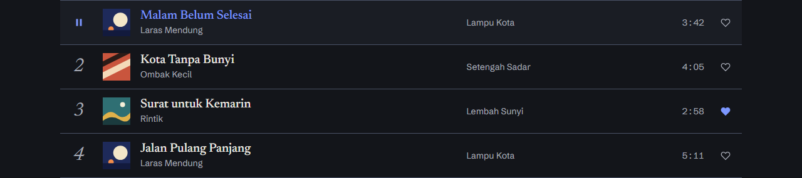
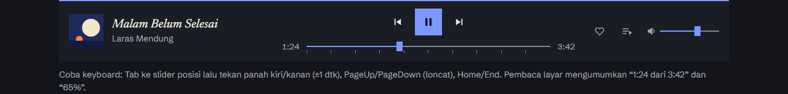

# Streaming — Design System "Tinta Cetak"

**Status:** v1 · **Tanggal:** 2026-11-06 · **Arah:** C · Tinta Cetak (dipilih dari tiga usulan) · **Acuan:** [`spec.md`](./spec.md), [`architecture.md`](./architecture.md)
**Sumber kebenaran token:** [`app/globals.css`](../app/globals.css) · **Komponen:** [`components/ui/`](../components/ui/) · **Halaman review:** `/gaya` (jalankan `npm run dev`, buka `http://localhost:3000/gaya`)

> Dokumen ini menjelaskan *mengapa* dan *bagaimana memakai*. Nilai warna dan ukuran yang tertulis di sini dibaca dari `globals.css` saat dokumen disusun; bila berbeda, `globals.css` yang benar. Tabel kontras dihasilkan oleh `npm run test:contrast` dan dijaga CI.

## 1. Ringkasan arah

Sampul piringan dan catatan liner. Grafit dingin sebagai latar, tinta krem sebagai teks, **satu** aksen biru kobalt. Judul memakai serif editorial (Newsreader, sering italic), teks dan kontrol memakai Schibsted Grotesk. Sudut tajam, garis tipis, dan nomor lagu italic besar seperti daftar lagu di sampul. Sampul lagu adalah bintangnya: UI sengaja netral supaya warna sampul pengguna, yang tak bisa kita kendalikan, selalu tampil baik.

Keputusan dari pemilik proyek:

1. Slider progres (penggaris) dan volume adalah kontrol sungguhan: dapat digeser dengan panah, fokus terlihat, nilai diumumkan sebagai teks ("1:24 dari 3:42").
2. Nomor lagu italic besar mengecil di layar ≤ 640px.
3. Sudut tajam untuk kartu, sampul, dan tombol; fokus keyboard tetap jelas (outline kobalt dengan offset).
4. Token status (sukses, peringatan, galat) berbeda dari kobalt, dan setiap status selalu disertai ikon dan teks.
5. Font lewat `next/font/google`, display swap, subset latin saja.

## 2. Prinsip

1. **Sampul dulu.** UI netral dan hemat warna. Aksen hanya untuk: tombol utama, fokus, lagu yang sedang diputar, dan isi slider.
2. **Satu aksen, satu tombol utama.** Maksimal satu tombol `primary` per tampilan. Aksi lain `secondary` atau `ghost`.
3. **Status tidak pernah hanya warna.** Setiap status = ikon berbentuk khas + judul + teks. Warna hanya penguat.
4. **Tajam dan datar.** Radius 0 di mana-mana. Pemisah berupa garis tipis atau selisih tona, bukan bayangan. Satu-satunya bayangan ada pada yang melayang (toast, dialog).
5. **Bisa dipakai tanpa mouse.** Semua kontrol dapat dijangkau dan dioperasikan dengan keyboard, punya nama aksesibel, dan fokusnya selalu terlihat.
6. **Teks nyata.** Label tampak (bukan placeholder), galat menjelaskan cara memperbaiki, aksi diberi nama sesuai akibatnya ("Hapus playlist", bukan "OK").
7. **Gerak seperlunya.** Pendek, fungsional, dan mati total pada pengaturan "kurangi gerakan".

## 3. Warna

Mode gelap adalah satu-satunya tampilan (`color-scheme: dark`). Tailwind bawaan dihapus (`--color-*: initial`), sehingga hanya token di bawah yang dapat dipakai (`bg-surface`, `text-muted`, `border-control`, ...). Hex tidak ditulis di komponen.

| Token | Hex | Utilitas | Peran |
|---|---|---|---|
| `ground` | `#13151A` | `bg-ground` / `text-ground` / `border-ground` | Latar halaman |
| `surface` | `#1A1D24` | `bg-surface` / `text-surface` / `border-surface` | Panel, baris aktif, player bar, input, dialog |
| `raised` | `#232731` | `bg-raised` / `text-raised` / `border-raised` | Hover, placeholder sampul, skeleton |
| `hairline` | `#4A5266` | `bg-hairline` / `text-hairline` / `border-hairline` | Pemisah dekoratif (boleh kontras rendah) |
| `control` | `#7B859C` | `bg-control` / `text-control` / `border-control` | Batas kontrol dan track slider (wajib ≥ 3:1) |
| `ink` | `#ECE9E2` | `bg-ink` / `text-ink` / `border-ink` | Teks utama |
| `muted` | `#A5A9B4` | `bg-muted` / `text-muted` / `border-muted` | Teks pendukung |
| `accent` | `#7C97FF` | `bg-accent` / `text-accent` / `border-accent` | Tombol utama, fokus, lagu aktif, isi slider |
| `accent-hover` | `#95AAFF` | `bg-accent-hover` / `text-accent-hover` / `border-accent-hover` | Hover tombol utama |
| `on-accent` | `#0B1020` | `bg-on-accent` / `text-on-accent` / `border-on-accent` | Teks di atas aksen |
| `success` | `#5CCB8C` | `bg-success` / `text-success` / `border-success` | Berhasil |
| `success-surface` | `#13241B` | `bg-success-surface` / `text-success-surface` / `border-success-surface` | Latar pesan berhasil |
| `warning` | `#F2B84B` | `bg-warning` / `text-warning` / `border-warning` | Perhatian |
| `warning-surface` | `#2A2210` | `bg-warning-surface` / `text-warning-surface` / `border-warning-surface` | Latar pesan perhatian |
| `error` | `#FF7B72` | `bg-error` / `text-error` / `border-error` | Gagal |
| `error-surface` | `#2B1517` | `bg-error-surface` / `text-error-surface` / `border-error-surface` | Latar pesan gagal |

Berlaku juga `--color-scrim` (latar belakang dialog, `bg-scrim`) dan `--shadow-float` (`shadow-float`).

### Aturan pemakaian

| Pakai | Untuk |
|---|---|
| `ground` | Latar halaman |
| `surface` | Panel, baris lagu aktif/hover, player bar, input, dialog |
| `raised` | Hover tombol sekunder, placeholder sampul, skeleton |
| `hairline` | Pemisah dekoratif (garis antar baris, bingkai kartu). Boleh kontras rendah karena tidak membawa informasi |
| `control` | Batas input, tombol sekunder, kotak kosong, dan track slider. **Wajib ≥ 3:1** |
| `ink` / `muted` | Teks utama / teks pendukung (artis, durasi, petunjuk) |
| `accent` | Tombol utama, cincin fokus, lagu aktif (teks + garis atas kartu), isi slider |
| `success` / `warning` / `error` | Hanya lewat `StatusMessage`, `InlineStatus`, `Toast`, dan tombol `danger` |

Jangan: memakai `accent` untuk status, memakai warna status sebagai hiasan, atau menaruh teks `muted` di atas permukaan di luar tabel kontras.

### Kontras terukur (WCAG 2.x)

Teks minimal 4,5:1; ikon, batas kontrol, dan cincin fokus minimal 3:1. Semua pasangan di bawah **lulus** dan diuji di CI (`npm run test:contrast`).

| Peran | Depan | Latar | Rasio | Minimum | Hasil |
|---|---|---|---|---|---|
| Teks utama | `ink` #ECE9E2 | `ground` #13151A | **15,06:1** | 4.5:1 | lulus |
| Teks utama | `ink` #ECE9E2 | `surface` #1A1D24 | **13,91:1** | 4.5:1 | lulus |
| Teks utama | `ink` #ECE9E2 | `raised` #232731 | **12,32:1** | 4.5:1 | lulus |
| Teks redup | `muted` #A5A9B4 | `ground` #13151A | **7,77:1** | 4.5:1 | lulus |
| Teks redup | `muted` #A5A9B4 | `surface` #1A1D24 | **7,18:1** | 4.5:1 | lulus |
| Teks redup | `muted` #A5A9B4 | `raised` #232731 | **6,35:1** | 4.5:1 | lulus |
| Aksen sebagai teks (lagu aktif) | `accent` #7C97FF | `ground` #13151A | **6,72:1** | 4.5:1 | lulus |
| Aksen sebagai teks (lagu aktif) | `accent` #7C97FF | `surface` #1A1D24 | **6,21:1** | 4.5:1 | lulus |
| Aksen sebagai teks (lagu aktif) | `accent` #7C97FF | `raised` #232731 | **5,50:1** | 4.5:1 | lulus |
| Teks pada tombol utama | `on-accent` #0B1020 | `accent` #7C97FF | **6,97:1** | 4.5:1 | lulus |
| Teks pada tombol utama (hover) | `on-accent` #0B1020 | `accent-hover` #95AAFF | **8,54:1** | 4.5:1 | lulus |
| Teks pesan status | `ink` #ECE9E2 | `success-surface` #13241B | **13,37:1** | 4.5:1 | lulus |
| Teks pesan status | `ink` #ECE9E2 | `warning-surface` #2A2210 | **12,98:1** | 4.5:1 | lulus |
| Teks pesan status | `ink` #ECE9E2 | `error-surface` #2B1517 | **14,17:1** | 4.5:1 | lulus |
| Judul status berwarna | `success` #5CCB8C | `success-surface` #13241B | **8,01:1** | 4.5:1 | lulus |
| Judul status berwarna | `warning` #F2B84B | `warning-surface` #2A2210 | **8,79:1** | 4.5:1 | lulus |
| Judul status berwarna | `error` #FF7B72 | `error-surface` #2B1517 | **6,81:1** | 4.5:1 | lulus |
| Ikon status | `success` #5CCB8C | `ground` #13151A | **9,02:1** | 3:1 | lulus |
| Ikon status | `warning` #F2B84B | `ground` #13151A | **10,20:1** | 3:1 | lulus |
| Ikon status | `error` #FF7B72 | `ground` #13151A | **7,24:1** | 3:1 | lulus |
| Batas kontrol (input, slider) | `control` #7B859C | `ground` #13151A | **4,94:1** | 3:1 | lulus |
| Batas kontrol (input, slider) | `control` #7B859C | `surface` #1A1D24 | **4,56:1** | 3:1 | lulus |
| Batas kontrol (input, slider) | `control` #7B859C | `raised` #232731 | **4,04:1** | 3:1 | lulus |
| Cincin fokus dan isi slider | `accent` #7C97FF | `ground` #13151A | **6,72:1** | 3:1 | lulus |
| Cincin fokus dan isi slider | `accent` #7C97FF | `surface` #1A1D24 | **6,21:1** | 3:1 | lulus |
| Cincin fokus dan isi slider | `accent` #7C97FF | `raised` #232731 | **5,50:1** | 3:1 | lulus |
| Cincin fokus pada pesan status | `accent` #7C97FF | `success-surface` #13241B | **5,96:1** | 3:1 | lulus |
| Cincin fokus pada pesan status | `accent` #7C97FF | `warning-surface` #2A2210 | **5,79:1** | 3:1 | lulus |
| Cincin fokus pada pesan status | `accent` #7C97FF | `error-surface` #2B1517 | **6,32:1** | 3:1 | lulus |

| Warna status | Selisih rona dengan aksen kobalt | Minimum | Hasil |
|---|---|---|---|
| `success` #5CCB8C | 82° | 60° | lulus |
| `warning` #F2B84B | 172° | 60° | lulus |
| `error` #FF7B72 | 136° | 60° | lulus |

Warna status berbeda dari kobalt dalam dua cara: rona dan **bentuk ikon** (lingkaran bercentang, segitiga, segi delapan). Pengguna buta warna tetap dapat membedakannya.

## 4. Tipografi

Dua keluarga, dimuat lewat `next/font/google` di `app/layout.tsx`: hanya subset `latin`, `display: "swap"`, variabel CSS `--font-newsreader` dan `--font-schibsted`. Geist sudah dihapus.

| Peran | Font | Dipakai untuk |
|---|---|---|
| `font-display` | Newsreader (variabel, sumbu `opsz`, normal + italic) | Judul halaman, nama lagu/album/artis, nomor lagu, judul dialog |
| `font-body` | Schibsted Grotesk (variabel) | Teks, label, kontrol, angka durasi |

| Token | Ukuran / tinggi baris | Peran |
|---|---|---|
| `text-hero` | 56px / 1,02 | Nama aplikasi di `/masuk`. Display italic |
| `text-display` | 40px / 1,08 | Judul bagian di `/gaya` dan halaman |
| `text-heading` | 28px / 1,15 | Judul panel, dialog |
| `text-title` | 20px / 1,25 | Nama lagu di kartu dan baris |
| `text-numeral` | 30px / 1 | Nomor lagu (italic). **≤ 640px: `text-numeral-sm` 20px** |
| `text-lead` | 18px / 1,5 | Paragraf pembuka |
| `text-body` | 16px / 1,55 | Teks biasa |
| `text-small` | 14px / 1,5 | Artis, album, galat, petunjuk |
| `text-caption` | 13px / 1,4 | Waktu pada slider, label kecil |

Aturan: huruf miring dipakai untuk judul, nama aplikasi, dan nomor lagu; bukan untuk teks panjang. Jangan memakai teks di bawah 13px dan jangan memakai huruf kapital semua dengan jarak lebar.

### Angka waktu (komponen `Time`)

Durasi dan posisi lagu harus sejajar di kolom, jadi memakai angka tabular (`tabular-nums`). Masalahnya, di Schibsted Grotesk fitur `tnum` ikut melebarkan **titik dua** dari 3,9px menjadi 8,9px (pada 14px), sehingga waktu terbaca "3 : 42" dan angka "1" berkaki seperti mesin tik. Lima varian dibandingkan ([gambar perbandingan](./images/waktu-perbandingan-varian.png)); lebar "3:42" pada 14px:

| Varian | Lebar "3:42" | Lebar titik dua | Kolom rata | Catatan |
|---|---|---|---|---|
| A. proporsional | 27,4px | 3,9px | **tidak** (1:24 = 24,6px, 0:08 = 29,5px) | rapat tetapi bergoyang |
| B. `tabular-nums` (sebelumnya) | 35,6px | 8,9px | ya | titik dua renggang |
| **C. angka tabular + titik dua proporsional (dipilih)** | **30,6px** | 3,9px | **ya** (semua "d:dd" 30,6px) | rapat dan rata |
| D. tnum + `case` | 35,6px | 8,9px | ya | sama dengan B |
| E. lnum + tnum | 35,6px | 8,9px | ya | sama dengan B |

`Time` merender angka tabular dan membungkus tiap titik dua dengan kelas `.colon` (`font-variant-numeric: proportional-nums`). Teks yang dibaca pembaca layar tetap "3:42". Pakai `Time` untuk semua waktu yang tampil; string `aria-valuetext` tidak perlu.

| | Baris lagu | Player bar |
|---|---|---|
| Sebelum |  |  |
| Sesudah |  |  |

## 5. Spasi, tata letak, radius, bayangan

- **Spasi:** kelipatan 4px (`--spacing: 0.25rem`): 4, 8, 12, 16, 24, 32, 48, 64. Jarak antar bagian halaman 40px ke atas; jarak dalam komponen 8–16px.
- **Gutter halaman:** 16px di ponsel, 32px di layar lebar. Konten maksimal 72rem.
- **Radius:** selalu 0. Utilitas `rounded-*` bawaan Tailwind dihapus (`--radius-*: initial`), jadi tidak ada yang bisa membulatkan elemen tanpa sengaja.
- **Bayangan:** hanya `shadow-float`, untuk toast dan dialog. Permukaan lain dipisahkan lewat selisih tona atau garis `hairline`.
- **Breakpoint** (varian kustom di `globals.css`, tepat "sampai dengan"): `phone:` = lebar ≤ 640px (nomor lagu mengecil, kolom album hilang), `tablet:` = lebar ≤ 760px (sidebar dan player bar digantikan `MiniPlayer` + `BottomNav`). Varian bawaan `max-[640px]` **tidak dipakai**, karena Tailwind menafsirkannya sebagai "< 640px".

## 6. Ikon

Set sendiri di `components/ui/icons.tsx` (tanpa dependensi): garis 1,8px, ujung persegi, ukuran mengikuti teks (`1em`). Ikon dekoratif `aria-hidden`; ikon yang berdiri sendiri harus diberi `title`, dan tombol hanya-ikon harus punya `aria-label` (dipaksa oleh tipe `Button`). Ikon status berbeda bentuk: `IconSuccess` (lingkaran), `IconWarning` (segitiga), `IconError` (segi delapan).

## 7. Gerak

| Token | Nilai | Dipakai untuk |
|---|---|---|
| `--duration-fast` | 120ms | hover dan tekan |
| `--duration-base` | 200ms | munculnya tombol putar di kartu |
| `--duration-slow` | 360ms | dialog dan perubahan besar |
| `--ease-out` | `cubic-bezier(0.2, 0.7, 0.2, 1)` | semua transisi masuk |

Hanya `opacity`, warna latar/batas/teks, dan transform yang dianimasikan. Jangan menganimasikan `outline-color`: cincin fokus harus muncul seketika (bug ini sempat terjadi dan dicegah dengan membatasi properti transisi tombol). Aturan global di `globals.css` mematikan animasi dan transisi pada `prefers-reduced-motion: reduce`. Indikator lagu aktif (`.eq`) berhenti saat dijeda.

## 8. Aksesibilitas

| Hal | Aturan | Terverifikasi |
|---|---|---|
| Fokus | Outline kobalt 2px, offset 3px pada semua elemen (aturan global `:focus-visible`); slider memakainya pada pembungkus | CI, Chrome |
| Slider | `<input type="range">` asli: panah ±step, Home/End, PageUp/PageDown; `aria-label` + `aria-valuetext` ("1:24 dari 3:42", "65%") | CI, Chrome |
| Tombol hanya-ikon | `aria-label` wajib (tipe) | tipe + lint |
| Status | Ikon + judul + teks; galat `role="alert"`, lainnya `role="status"` | kode |
| Lagu aktif | `aria-current`, label "Sedang diputar", garis aksen (bukan warna saja) | kode |
| Toggle (suka) | `aria-pressed` dan label berubah ("Sukai" / "Batal suka") | kode |
| Dialog | Elemen `<dialog>` asli: fokus terkunci, Esc menutup, fokus kembali ke pemicu | kode (perilaku bawaan browser) |
| Navigasi aktif | `aria-current="page"` + garis kiri + teks aksen | kode |
| Pencarian | Formulir GET `role="search"` dengan label tersembunyi; bekerja tanpa JavaScript | kode |
| Gerak | Dimatikan pada "kurangi gerakan" | kode |
| Ukuran target | Tombol ≥ 32px (ikon) dan ≥ 40px untuk pemutar utama; di atas minimum WCAG 2.2 (24px) | kode |

Yang **belum** diuji: pembaca layar sungguhan (NVDA/VoiceOver; hanya atribut ARIA yang diperiksa), Firefox dan Safari (ujung slider dan `:has()` di sana belum dilihat), layar sentuh nyata.

## 9. Komponen

Semua di `components/ui/`, dapat dilihat dan dicoba di `/gaya`. Komponen bersifat presentasional; state pemutar dan data datang dari store pada Fase 2.

### Tombol (`Button`)
- **Varian:** `primary` (kobalt, maks. satu per tampilan), `secondary` (batas `control`), `ghost`, `danger` (batas dan teks `error`, untuk aksi merusak). **Ukuran:** `sm` 32px, `md` 40px, `lg` 48px. **State:** default, hover, fokus, nonaktif (opacity 50%), `loading` (nonaktif + `aria-busy` + indikator gerak, label tetap).
- Hanya-ikon: `iconOnly` + `aria-label` wajib. Sudut tajam. Transisi hanya warna latar/batas/teks.

### Input (`TextField`)
- Label selalu tampak, petunjuk opsional (`aria-describedby`), galat memakai `InlineStatus` (ikon + teks) dan `aria-invalid`. Batas `control` (3:1), hover batas `ink`. State: default, fokus, galat, nonaktif.

### Status (`StatusMessage`, `InlineStatus`)
- `StatusMessage`: kotak dengan garis atas 2px berwarna status, ikon, judul (bawaan "Berhasil" / "Perhatian" / "Gagal"), dan teks. `InlineStatus`: satu baris untuk di bawah kolom isian.

### Sampul (`Cover`)
- Persegi 1:1, sudut tajam. Tanpa gambar: placeholder `raised` + ikon nada. `alt` kosong bila judul ada di sampingnya.

### Kartu lagu (`SongCard`)
- Sampul + garis atas + judul (Newsreader 20px) + artis. Tombol putar muncul saat hover/fokus (selalu tampak di perangkat sentuh dan pada lagu aktif). **Aktif:** garis atas aksen 3px, judul aksen, label "Sedang diputar" dengan indikator gerak; **dijeda:** label "Dijeda", indikator diam.

### Kartu album/artis (`MediaCard`)
- Satu tautan menutupi kartu; album punya tombol putar terpisah di atasnya. Subjudul: "Artis · 2024" atau "Artis · 14 lagu".

### Baris lagu (`SongRow`)
- Kolom: nomor/putar · sampul · judul+artis · album · durasi · suka. Nomor italic besar 30px, **20px di ≤ 640px**, kolom album hilang di ≤ 640px. Hover menampilkan ikon putar menggantikan nomor. **Aktif:** latar `surface`, teks aksen, ikon jeda/putar. **Disukai:** hati terisi aksen, `aria-pressed`.

### Player bar (`PlayerBar`)
- Garis atas aksen 2px, latar `surface`. Tiga kolom: lagu · kontrol + slider posisi · suka, antrean, volume. ≤ 760px menumpuk dan menyembunyikan volume dan aksi samping. Wilayah `aria-live` mengumumkan perubahan lagu.

### Mini-player (`MiniPlayer`), pemutar penuh (`FullPlayer`), dan navigasi bawah (`BottomNav`) — ponsel ≤ 760px
Menggantikan sidebar dan player bar di layar kecil. Sebelumnya navigasi atas + player bar memakan ±220px tinggi layar; sekarang mini-player ±58px + navigasi bawah ±56px (< 130px, dijaga E2E). Perbandingan: [sebelum](./images/fase2/ponsel-sebelum-redesain/ponsel-beranda.png) dan [sesudah](./images/fase2/ponsel-beranda.png).
- **`MiniPlayer`:** satu baris: sampul 40px, judul (Newsreader italic) + artis, tombol putar/jeda aksen 44px, tombol berikutnya. Progres hanya garis 2px di tepi atas (dekoratif, `aria-hidden`). Mengetuk area lagu membuka `FullPlayer` (tombol bernama "Buka pemutar: judul, artis"). Pembaca layar mendengar perubahan lagu lewat wilayah `aria-live`.
- **`FullPlayer`:** layar penuh di atas `<dialog>` asli (fokus terkunci, Esc menutup, fokus kembali ke mini-player). Sampul besar (maks 20rem), judul, artis, slider posisi (penggaris; panah, Home/End, `aria-valuetext` "1:24 dari 3:42"), kontrol besar (putar 64px), tombol "Antrean". Volume tidak ada karena diatur perangkat. Memperhatikan area aman atas dan bawah.
- **`BottomNav`:** empat tujuan (Beranda, Cari, Library, Disukai), ikon di atas label, tinggi ≥ 56px. Aktif: teks aksen + garis atas 3px + `aria-current="page"`. Memperhatikan `safe-area-inset-bottom`.
- Hanya satu pemutar (PlayerBar atau MiniPlayer) yang ada di pohon aksesibilitas pada satu waktu: yang lain `display: none`.

### Slider progres dan volume (`Slider`)
- `variant="ruler"` (penggaris dengan tanda tiap 10%, untuk posisi lagu) dan `"line"` (volume). Isi aksen, track `control`, jempol persegi 10×16px. Langkah posisi 1 detik, volume 5.
- Bukan komponen buatan sendiri: input range asli, jadi keyboard dan pembaca layar bekerja tanpa kode tambahan.

### Sidebar (`Sidebar`)
- Navigasi utama (Beranda, Cari, Library, Lagu Disukai) dan daftar playlist; hanya desktop. Item aktif: `aria-current="page"`, garis kiri 3px, teks aksen. Lebar 16rem, setinggi kolomnya. Item navigasi dibagi dengan `BottomNav` lewat `components/ui/nav-items.ts`.

### Header pencarian (`SearchHeader`)
- Formulir GET ke `/cari?q=`; bekerja tanpa JavaScript dan URL hasil dapat dibagikan. Slot kanan untuk menu pengguna.

### Toast (`Toast`, `ToastRegion`)
- Memakai `StatusMessage`, melayang dengan `shadow-float`, tombol tutup, aksi opsional ("Urungkan"). Galat `role="alert"`, lainnya `role="status"`. Toast berisi aksi atau galat tidak ditutup otomatis; yang lain ≥ 6 detik.

### Dialog (`Dialog`)
- Di atas `<dialog>` asli (modal). Judul Newsreader 28px, deskripsi, aksi di kanan bawah. Aksi merusak memakai tombol `danger`; aksi aman diletakkan lebih dulu.

### Keadaan kosong (`EmptyState`)
- Bingkai putus-putus `control`, ikon, judul italic, penjelasan, dan **satu** aksi berikutnya. Bingkai tidak runtuh saat kosong.

### Skeleton (`Skeleton`, `SkeletonGroup`, `SongCardSkeleton`, `SongRowSkeleton`)
- Blok `raised` berdenyut (opacity saja). Dibungkus `SkeletonGroup` (`role="status"`, "Memuat…") agar pembaca layar mendengarnya sekali.

## 10. Do dan Don't

| Lakukan | Jangan |
|---|---|
| Satu tombol `primary` per tampilan | Dua tombol kobalt bersaing |
| Status = ikon + judul + teks | Hanya warna, atau ikon tanpa teks |
| Nama aksi sesuai akibat ("Hapus playlist") | "OK" / "Ya" |
| Token (`bg-surface`, `text-muted`) | Hex atau `bg-zinc-800` di komponen |
| `phone:` / `tablet:` untuk breakpoint | `max-[640px]:` (berarti < 640px) |
| `cn()` dari `lib/cn.ts` untuk menggabung kelas | Menggabung kelas dengan template string (tabrakan tidak terselesaikan) |
| `<Time seconds={…} />` untuk waktu | `tabular-nums` langsung pada teks "3:42" (titik dua melebar) |
| Biarkan sampul tampil apa adanya | Menimpa sampul dengan filter atau overlay gelap tebal |
| Anim `opacity` dan warna latar | Transisi `outline-color` atau `all` |

## 11. Pengujian

| Uji | Perintah | Mencakup | CI |
|---|---|---|---|
| Kontras token | `npm run test:contrast` | 29 pasangan kontras + 3 cek rona status vs kobalt, dibaca dari `globals.css` | workflow `app` |
| Keyboard + tampilan | `npm run test:keyboard` (butuh server dan Chrome) | Tab ke slider, cincin fokus, panah/Home/End, `aria-valuetext`, fokus tombol, sudut tajam, nomor 30px→20px pada 641→640px | workflow `app` |
| `cn()` | `npm run test:cn` | Tabrakan kelas (`w-full` + `size-10`, `bg-raised` + `bg-surface`, ukuran vs warna `text-*`, varian `phone:`), dan setiap token di `globals.css` terdaftar. Tailwind-merge sudah memperlakukan nilai `bg-`/`text-` tak dikenal sebagai warna, jadi pendaftaran warna adalah sabuk pengaman; pendaftaran ukuran huruf, font, dan `shadow-float` yang menentukan (diuji dengan mutasi) | workflow `app` |
| Lint, tipe, build | `npm run lint`, `npx tsc --noEmit`, `npm run build` | seluruh aplikasi termasuk `/gaya` | workflow `app` |

## 12. Belum diputuskan atau belum dikerjakan

- Halaman utama Fase 3 (pencarian, library, disukai, playlist) belum dirancang; komponen dasarnya sudah ada. Antrean di ponsel masih dialog biasa, bukan lembar bawah.
- `next/image` untuk sampul Supabase belum dikonfigurasi (`Cover` memakai `` dengan `loading="lazy"`).
- Mode terang tidak ada dan tidak direncanakan.
- Tema warna dari sampul lagu (ambient) sengaja tidak dipakai: aksen tetap kobalt.
- Pengujian pembaca layar sungguhan dan browser selain Chrome.
